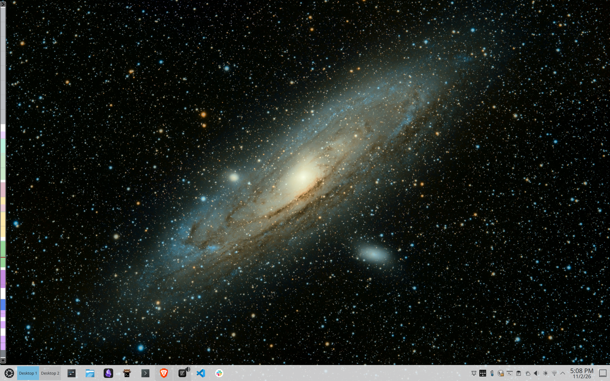
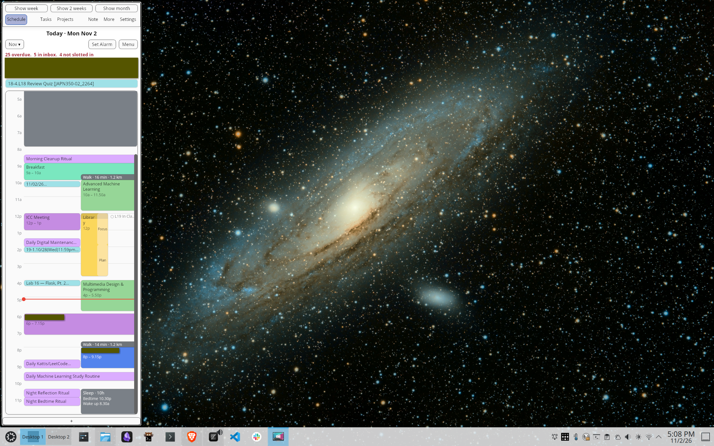
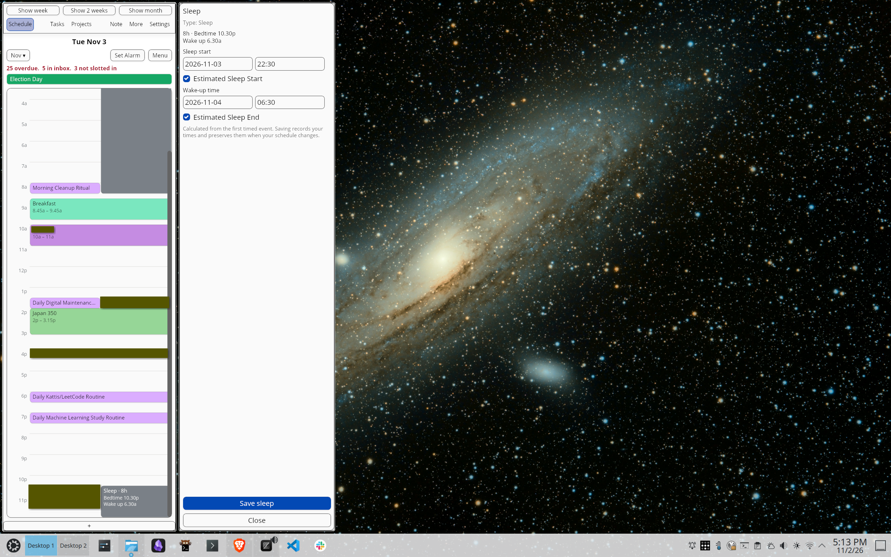
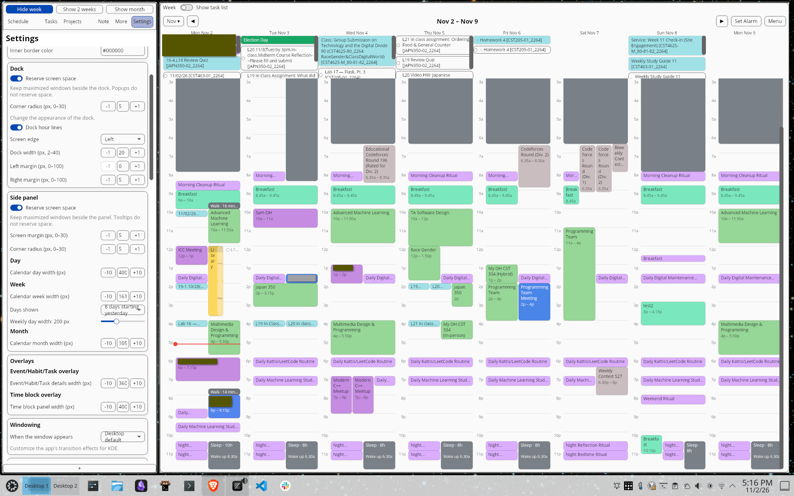

# TimeSlay

Easily manage your life using a single app. It is designed to minimize friction and maximize your time spent in flow state.

## Tour

Docked mode is the feature that I love the most. Your day is always at a glance. You can still hover over and edit events/tasks from this view:

But you'll typically plan the day within the larger panel:

Editing details for events, tasks, time blocks, and more is done within a popup overlay:

Of course, there's also week, 2-week, and month views:

## Features

- Intuitive to use.
- Stays out of your way during work, but is easily accessible when needed.
	- Toggle between "docked" and "panel" mode as shown above (<kbd>Meta+F</kbd>).
	- Toggle between fully hiding and showing the app (<kbd>Meta+Shift+F</kbd>).
	- Takes up full screen when showing lots of data.
	- Configure dock or panel to either show above existing apps or take up space.
	- Configure widths of dock, panel, and side overlays.
- **View your time:**
	- By day, week, 2 weeks, or month.
	- Allow zoom in and zoom out on day/week views.
	- Toggle visibility of Google Calendars, Google Task Lists, and TimeSlay-specific events.
	- Apply custom search or filter:
		- Show only events that satisfy a filter, like string search, time of day, project, availability, public visibility, location, and more.
- **Manage your calendar:**
	- **Events:**
		- Manage the same event metadata as Google Calendar, plus projects, and tags.
		- Create Google Meet and Zoom meetings; manage guest lists.
		- Show join buttons for Google Meet and Zoom meetings.
		- Send replies to [event invitations](https://support.google.com/calendar/answer/37135?hl=en&co=GENIE.Platform%3DDesktop).
		- Location
			- Estimate travel time and distance based on event locations.
			- Open locations or trip in Google Maps or OpenStreetMap.
	- **Time blocks:**
		- Like a regular event, but has special interface for planning and focusing for many tasks or deep work.
		- Easily add/remove tasks to the time block.
		- Has special focus mode:
			- Area to brain dump.
			- Automatic pomodoro timer.
			- Record distractions (integratead with habits) (TODO).
	- **Sleep:**
		- Like a regular event, but automatically create events for sleep based on sleep goal, next days' activities, and latest wakeup time.
		- Sleep quality tracking (TODO).
		- Automatic shutdown (TODO).
- **Capture and manage tasks**:
	- Manage the same task metadata as Google Tasks, plus projects, tags, priorities, projects, and estimated duration.
	- Create tasks:
		- By text input
			- Supports [Todoist keywords](https://www.todoist.com/help/todoist/features/use-task-quick-add-in-todoist-va4Lhpzz).
			- Supports pasting Gmail URLs
		- By speaking.
		- By taking, uploading, or pasting pictures (TODO).
		- From the browser extension, when on a web page
		- From the Slack app, for a specific message
	- Inbox section for new tasks that have yet to be triaged.
	- Overdue section for uncompleted past tasks that need to be reprioritized or rescheduled.
	- Today section for current-day tasks without a due time.
	- Segmented backlog section for deferring tasks to next week, next month, and so on.
	- Schedule tasks:
		- Manually assign tasks to a day, time, or time blocks.
		- _Automatically project tasks from a non-temporal, grouped and ordered list of tasks to the day's available time blocks (TODO)._
		- "Do immediately" etc. No need to categorize other than project (TODO?).
	- Handle long-running or multi-step/subtasks (TODO).
		- Plan to do one task, but turns out, I have to do something smaller, and defer the original task. Easily do that.
		- Tasks that may be done over multiple days/time blocks (TODO).
		- When recording during time block, already have multiple recorded sessions. Can cancel which removes task from todo, but keeps history (TODO).
		- But, also keep track of subtasks (TODO?).
		- Waiting for reply email (waiting-for tag), once reply, put back in to-do but if not, wait until date to do so. or AI to detect.
- **Manage Habits**
	- Like a regular calendar event, but colored differently and managed differently (UPDATE?).
	- Distinguish between habits to do, and ones to avoid.
	- Allow adding data to habits
	- Allow connecting habit to specific objectives like weight loss (TODO).
	- For habits that can be done anytime during the week, "float" them in the day/week view (TODO)
	- Show habits configurable amount of days before they are due so they can be scheduled before they are due (TODO)
- **Notes:**
	- Associate notes and files with events, tasks, goals, objectives, projects, and people.
	- Local/url (TODO).
- **Project sessions:** (TODO)
	- _Configure presets of applications and their positions for easy launching per project (TODO)._
- **Set goals:** (TODO)
	- Track long-term goals (year, decade).
- **Set objectives:** (TODO)
	- Implement your goals in a SMART way.
	- Tasks, certain amount of time per project. (TODO)
	- Day, week, month, quarter, year. (TODO)
- **Manage projects:** (TODO)
	- Groups related events, tasks, notes, autolaunchers, objectives, and goals.
	- View as list, kanban, or calendar (TODO).
	- During events and tasks associated with a project, easily launch and position the apps/windows necesssary to do the work. (TODO)
	- Allow voice recording ideas related to project, and AI process into summary that might be general idea, or actual task (TODO).
- **Remember people:**
	- Browse and edit contacts from Google accounts and Google workspace directories.
	- Associate people with events, tasks, and projects (TODO).
	- One-click contact methos for email, Slack (TODO).
- Stores data in Google Calendar, Tasks and Contacts, and syncs app-specific data through Turso.
	- Uses local database as cache to keep UI performant/responsive.
- **Integrations:**
	- Slack
	- WebExtension
	- Gmail
- **Track data:** (TODO)
	- Journaling (voice to text)
	- Project allocation
	- Deep deep work/Distractions
	- locations been
	- Location and exercise
	- Food?

## More

See [Documentation](./docs/index.md) for more details.
