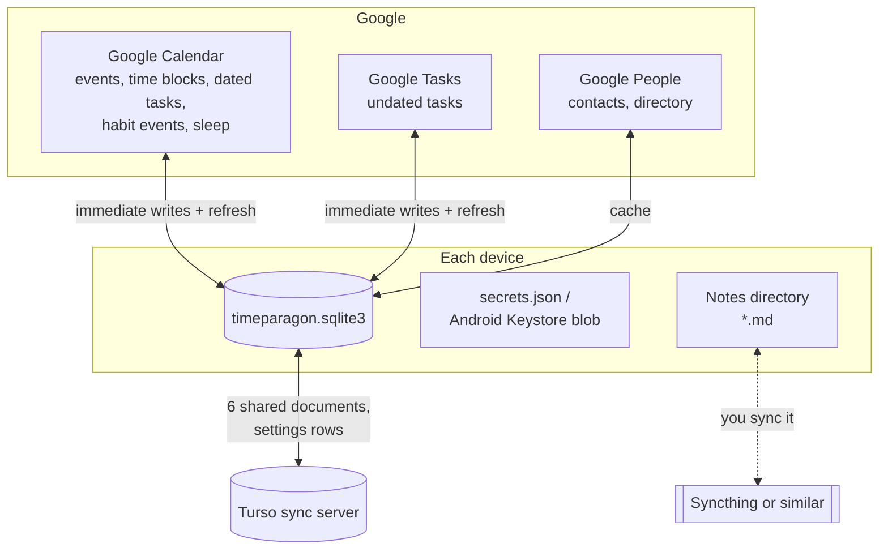
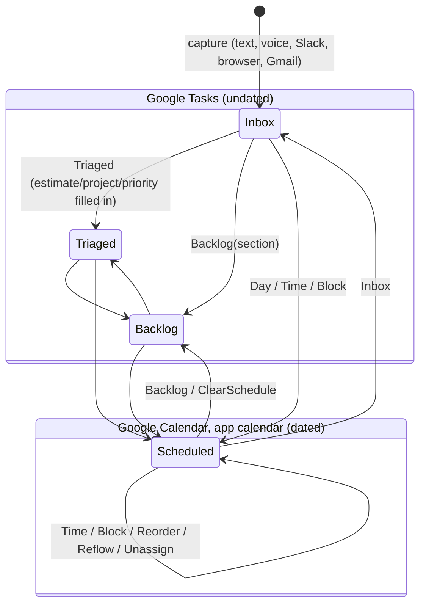
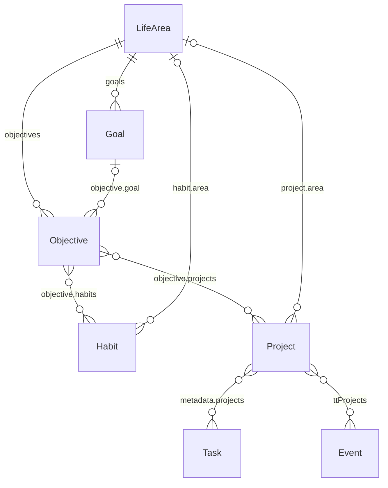

# Data model

This document covers what TimeParagon stores, where each piece lives, how the
pieces refer to each other, and the exact shape each one has on disk or on
Google. The SQLite tables are described column by column in the
[database schema](./database-schema.md).

## Where data lives

TimeParagon is local-first, and it has no backend of its own. Data is kept in
whichever store suits it best:



| Store | Owns | Shared between devices by |
| --- | --- | --- |
| **Google Calendar** | Events, time blocks, scheduled (dated) tasks, habit occurrences, sleep nights, meeting guests and replies | Google |
| **Google Tasks** | Undated tasks (inbox, triaged, backlog) | Google |
| **Google People** | Contacts, contact groups, Workspace directory | Google |
| **SQLite** `timeparagon.sqlite3` | Habits, alarms, notepad, brain dump, projects and life areas, work sessions, [settings](#settings) (calendar choices, colors, places and travel, reminders, sleep schedule, …); caches of everything Google owns; local copies of edits being sent to Google | Turso, for six documents and the synced settings tables |
| **`secrets.json`** | Google tokens, connected Gmail accounts, OpenRouter token | Not shared |
| **Notes directory** | Markdown notes, one file each | Whatever syncs the folder (Syncthing, say) |

Google is authoritative for everything it stores. SQLite holds a cache of that
data so the app starts instantly and can be read offline. Changes are sent to
Google straight away; the changed item shows greyed out and locked until Google
accepts it, and a refused change is undone and logged. There is no queue, so
changes cannot be made offline (see
[Google writes](./database-schema.md#google-writes)).

### File locations

Paths use the XDG directories for app ID `dev.TimeParagon.timeparagon`.
The project used to be called TimeSlay. On first start the app moves each
`timeslay` directory to its `timeparagon` name (unless that already exists)
and renames `timeslay.sqlite3` to `timeparagon.sqlite3`; see
`config::migrate_legacy_dirs`.

| File | Linux |
| --- | --- |
| Database (settings included) | `~/.local/share/timeparagon/timeparagon.sqlite3` |
| Settings of older versions | `~/.config/timeparagon/config.toml`, imported once and renamed `config.toml.imported` (see [Settings](#settings)) |
| Turso replica | `~/.local/share/timeparagon/turso/replica.db` |
| Secrets | `~/.local/state/timeparagon/secrets.json` (mode `0600`) |
| IPC sockets | `$XDG_RUNTIME_DIR/timeparagon-sidebar.sock`, `timeparagon-dock.sock` |

On Android the database is at `<files dir>/data/timeparagon/timeparagon.sqlite3`.
Google tokens are encrypted with an AES key held in Android Keystore
(alias `dev.kofler.timeparagon.google-tokens.v1`) and stored in the no-backup directory.
The notes folder is chosen with the system folder picker.

Test runs (`config::isolated()`) redirect every one of these paths to a
scratch directory and never contact Google or the sync server.

### What is shared between devices

Turso replicates exactly these `documents` rows (`database_sync::SHARED_KEYS`),
and every row of the synced [settings tables](#settings):

| Document | Holds |
| --- | --- |
| `habits` | [Habits](#habits) |
| `alarms` | [Alarms](#alarms) |
| `shared.notepad` | [Notepad](#notepad-and-brain-dump) text |
| `shared.brain_dump` | [Brain dump](#notepad-and-brain-dump) pages |
| `shared.projects` | [Projects, life areas, goals, objectives](#life-areas-goals-objectives-and-projects) |
| `shared.task_work` | [Work sessions and distractions](#work-sessions-distractions-and-pomodoro) |

The `shared.` prefix does not mean "synced". It marks the documents that the
apps' `Config` holds as sections (once part of `config.toml`), which
`shared_data` reads and writes. `habits` and `alarms` have their own libraries
and keys (`task_db::keys`), so they have no prefix, but they are synced all the
same. Only `SHARED_KEYS` decides what is replicated.

Everything else stays on the device. That includes the Google caches and the
local copies of edits being sent (each device talks to Google itself), contacts, cached routes,
calendar sync state, the Android theme, `device_settings`, secrets and
notes.

Concurrent edits are merged **field by field**, not by whichever document was
saved last. See [Merge rules](./database-schema.md#merge-rules). This is why
every list item in a shared document has a stable identity field.

---

## Identifiers

Many kinds of ID appear in the data. This table lists them all:

| ID | Format | Example | Defined in |
| --- | --- | --- | --- |
| Google calendar ID | Google's | `abc123@group.calendar.google.com`, `primary` | Google |
| Task-list "calendar" ID | `tasks:` + list ID | `tasks:MDk2NjQ…` | `calendar::ids::calendar_id` |
| Google event ID | Google's (base32hex) | `5ok3…_20261109T090000Z` | Google |
| Google task "event" ID | `task:` + task ID | `task:dGhpcyBp…` | `calendar::ids::event_id` |
| Dated task event ID | `tt` + 32 hex | `tt3f9a…` | `calendar_tasks::apply` |
| Sleep event ID | `51ee9` + `YYYYMMDD` (wake date) | `51ee920261110` | `calendar::sleep::event_id` |
| **TimeParagon task ID** | integer ≥ 100, < 2⁶² | `2875093487120931` | `task_db::Database::import` |
| Block key | `<calendar_id>/<event_id>` | `abc@group…/5ok3…` | `timeblocking::block_key` |
| Task key | task ID, or `<task id>/<event id>` for an occurrence of a recurring dated task | `2875…` | `timeblocking::task_key` |
| Habit ID | string | `h1`, random | `habits::Habit::id` |
| Habit section ID | string | | `habits::Section::id` |
| Alarm ID | random `u64` | | `alarms::new_id` |
| Project / life area / goal / objective / place ID | `u64` | Personal area is always `1` | `config`, `places` |
| Note | its file name (`<title>.md`) | `Groceries.md` | `notes::files` |
| Contact | People API resource name | `people/c123…` | Google |
| Edited item (`google_entities.id`) | `<calendar_id>\n<event_id>` | | `operations::key` |
| Sync edit | 32 random hex chars, or `snapshot-` + 32 hex | | `database_sync` |

Names are never used as references. Tasks refer to projects, places and
time blocks by ID, so you can rename those freely.

---

## Calendar

### Calendar

`calendar::Calendar` is one source shown in the calendar list:

| Field | Type | Notes |
| --- | --- | --- |
| `id` | string | Google calendar ID, or `tasks:<listId>` for a Google Tasks list |
| `name` | string | |
| `color` | color | Google's color, which a `calendar_sources` row can override |
| `primary` | bool | The account's primary calendar |
| `selected_by_google` | bool | Checked in Google Calendar's own list |

Google Tasks lists are shown as **synthetic calendars** whose IDs start with
`tasks:`. Three list names are reserved for the task workflow and are not
shown as calendar sources: `Inbox`, `Triaged` and `Backlog` (or the lists
configured as `inbox_list`, `triaged_list` and `backlog_list`).

The **app calendar** is the one Google calendar TimeParagon writes its own items
to. It is named `TimeParagon` and its ID is recorded as the `calendar.app_calendar`
setting.
It holds time blocks, all-day app events, dated tasks, habit occurrences and
sleep.

The catalog of calendars and the time of the last successful refresh are cached
in the `calendar_sync_state` document, so a restart can show source names and
honor the sync interval.

### Event

`calendar::Event` is the single type for everything placed on the calendar,
including Google Tasks:

| Field | Type | Notes |
| --- | --- | --- |
| `id` | string | See [Identifiers](#identifiers) |
| `calendar_id` | string | |
| `title` | string | `(No title)` when Google's summary is empty |
| `start`, `end` | datetime (local) | All-day `end` is exclusive, as in Google |
| `all_day` | bool | |
| `color` | color | Already resolved for display |
| `completed` | bool | Completed or ignored task, or done habit occurrence |
| `details` | `Details` | Everything below |

`calendar::Details`:

| Field | Type | Source on Google |
| --- | --- | --- |
| `description` | string | Event `description` (HTML converted to plain text) or the prose part of a task's notes |
| `location` | string | `location` |
| `status` | string | `Confirmed` / `Tentative` / `Cancelled` |
| `link` | string | `htmlLink` |
| `meeting` | string | `hangoutLink`, else the first video entry point of `conferenceData` |
| `organizer` | string | |
| `attendees` | string[] | Display labels |
| `attendance` | `meeting::Attendance` | Guests as data, see [Meetings](#meetings) |
| `recurrence` | string[] | Raw RFC 5545 lines (`RRULE:`, `RDATE:`, `EXDATE:`) |
| `recurring_event_id` | string? | The series this occurrence belongs to |
| `color_id` | string? | Google `colorId`. `None` means the calendar's color |
| `options` | `EventOptions` | Reminders, availability, visibility, inherited child metadata |
| `projects` | `u64[]` | `ttProjects` |
| `labels` | string[] | `ttLabels` |
| `habit` | bool | `ttKind = "habit"` |
| `habit_id` | string? | `ttHabit` |
| `habit_completed_at` | datetime? | `ttCompletedAt` |
| `sleep` | `sleep::Record`? | `ttKind = "sleep"` + `ttSleep` |
| `task_data` | `TaskData`? | A task's TimeParagon ID and metadata, see [Tasks](#tasks) |
| `task_updated_at` | datetime? | Google Tasks `updated` |

`EventOptions`:

| Field | Type | Google field |
| --- | --- | --- |
| `reminders` | `{useDefault, overrides: [{method, minutes}]}` | `reminders` (`method`: `popup` / `email`; at most 5 overrides) |
| `default_reminders` | `Reminder[]` | The calendar's defaults from `events.list` (read only) |
| `transparency` | `opaque` (Busy) / `transparent` (Free) | `transparency` |
| `visibility` | `default` / `public` / `private` / `confidential` | `visibility` |

### What kind of item an event is

Google only knows about events and tasks. TimeParagon works out its own kinds
from the metadata (`Event::kind`), checking these rules in order:

| Kind | Rule | Chip |
| --- | --- | --- |
| `Sleep` | `details.sleep` is set | Sleep |
| `Habit` | `details.habit` | Habit |
| `ScheduledTask` | It is a task, but not on a `tasks:` list (a dated task on the app calendar) | Task |
| `Task` | `task_data` is set, or the ID starts with `task:`, or the calendar ID starts with `tasks:` | Task |
| `TimeBlock` | On the app calendar and timed | Time Block |
| `AppEvent` | On the app calendar and all-day | Event |
| `External` | Anything else | Event |

### Google extended properties

TimeParagon stores its own data in **private** extended properties
(`extendedProperties.private`). These are only visible to the account that
wrote them. All values are strings, and Google limits each one to 1024
characters.

| Property | On | Value |
| --- | --- | --- |
| `ttKind` | Dated tasks, habit occurrences, sleep | `"task"`, `"habit"` or `"sleep"` |
| `ttData0` … `ttDataN` | Dated tasks | Chunks of the JSON-encoded `TaskData`, at most 900 bytes each |
| `ttDataCount` | Dated tasks | Number of chunks, `"1"`–`"200"` (at most 28 000 bytes in total) |
| `ttCompleted` | Dated tasks, habit occurrences | `"true"` / `"false"` |
| `ttCompletedAt` | Habit occurrences | RFC 3339 time it was marked done, or `null` |
| `ttHabit` | Habit occurrences | The [habit](#habits) ID it counts towards |
| `ttProjects` | Any event | JSON array of project IDs, e.g. `"[7,3]"` |
| `ttLabels` | Any event | JSON array of strings, e.g. `"[\"work\"]"` |
| `ttSplitFrom` | Recurring events split by this app | JSON array of the `calendar/series` names the series continues, oldest first. See [Time blocks](#time-blocks) |
| `ttSleep` | Sleep | JSON `sleep::Record` |
| `ttSleepDate` | Sleep | Wake date `YYYY-MM-DD`, used to look the night up with `privateExtendedProperty` |

When TimeParagon patches an event it keeps any extended properties it does not
know about.

---

## Tasks

A task lives in **Google Tasks** while it has no date, and as a **Google
Calendar event on the app calendar** once it is scheduled
(`calendar_tasks.rs`: "Scheduled tasks are Calendar events. Google Tasks holds
only undated work."). Moving between the two changes the task's Google ID.
Its TimeParagon ID stays the same.



| Where | Representation | Where metadata lives |
| --- | --- | --- |
| Undated: `Inbox` / `Triaged` / `Backlog` list | Google Task. `Event.id = task:<id>`, `calendar_id = tasks:<list>`. Internally its date is the sentinel `1970-01-01` (`timeblocking::UNDATED`) | Footer of the task's `notes` |
| Dated, all-day ("do on this day") | All-day Calendar event, `ttKind = task` | `ttData*` properties |
| Dated, timed or in a time block | Timed Calendar event, `ttKind = task` | `ttData*` properties |

Before Google has assigned an ID, a new undated task is shown with the
placeholder ID `task:tt<32-hex TimeParagon ID>` on a `tasks:local-inbox`,
`tasks:local-triaged` or `tasks:local-backlog` list. A new dated task is
placed on `local-calendar` until the app calendar is known.

### Task status

| Status | `Event.completed` | `metadata.ignored` | Google Tasks `status` | Calendar `ttCompleted` |
| --- | --- | --- | --- | --- |
| Active | `false` | `false` | `needsAction` | `"false"` |
| Completed | `true` | `false` | `completed` | `"true"` |
| Ignored | `true` | `true` | `completed` | `"true"` |

Google has no "ignored" state. An ignored task counts as completed in Google,
and TimeParagon tells the two apart with the `ignored` flag.

A task is **overdue** if it is neither completed nor ignored and was due
before today. It is **inboxed** if it is still waiting to be organized.

### Task metadata

`task_db::TaskData` is `{ id, metadata }`. `id` is the TimeParagon task ID, and
`metadata` is `timeblocking::Metadata`. Unknown fields are rejected
(`deny_unknown_fields`), so an older build never overwrites data written by a
newer one.

| Field | Type | Default | Meaning |
| --- | --- | --- | --- |
| `minutes` | `u32` | required | Estimated duration. A timed task's length. `0` = no estimate (placed as 30 min) |
| `block` | string? | required (nullable) | For a one-off in a time block, the block key of the occurrence it is in. Ignored on an occurrence of a task repeating with a block. See [Time blocks](#time-blocks) |
| `block_series` | string? | — | For a task repeating with a time block, the block's series as `<calendar>/<series id>`. See [Time blocks](#time-blocks) |
| `order` | `i64` | `0` | Position within its block or day |
| `ignored` | bool | `false` | See [Task status](#task-status) |
| `backlog_section` | enum | `someday` | `next_week_or_two`, `next_month`, `next_quarter`, `next_year`, `someday`, `never`. A planning horizon. It does not change due dates |
| `deadline` | `{date, time?}`? | — | When the task must be finished. Without a time, the whole day counts |
| `priority` | `"P1"` / `"P2"`? | — | `P1` is the most urgent. Unset means no priority |
| `projects` | `u64[]` | `[]` | [Project](#life-areas-goals-objectives-and-projects) IDs |
| `labels` | string[] | `[]` | Free-form labels |
| `location` | `u64`? | — | [Place](#places-and-travel) ID |
| `created_at` | datetime (UTC)? | — | Set only for tasks created in TimeParagon |
| `repeat_source` | `i64`? | — | No longer written. Read so older tasks still load |

Fields that are empty or `None` are left out when serializing.

#### Encoding in Google Tasks notes

An undated task stores its metadata after its notes, below a final `---`
line. Each field goes on its own line with a `tt-` prefix, and every value is
JSON:

```text
Pick up the dry cleaning before Friday.
---
tt-version: 1
tt-id: 2875093487120931
tt-deadline: {"date":"2026-11-13","time":null}
tt-backlog_section: "someday"
tt-block: null
tt-minutes: 15
tt-order: 0
tt-ignored: false
tt-projects: [7]
```

Rules (`calendar::task_metadata`):

- A footer only counts if it starts with `tt-version:`. A `---` the user typed
  is treated as ordinary text.
- `tt-version` must be `1`. `tt-id` must be ≥ 100. Duplicate keys or
  unknown keys are errors ("update the app before editing"). Malformed
  metadata is never overwritten.
- Notes and footer together must fit in Google Tasks' 8192-character limit.
- Everything before the footer is the task's description.

#### Encoding in Calendar events

A dated task stores the same `TaskData` as compact JSON, split into
`ttData0…ttDataN` with `ttDataCount = N+1` (see
[extended properties](#google-extended-properties)). `ttProjects` and `ttLabels`
are also written separately and **take precedence** over the copies inside
`ttData` when reading. The event's `description` is the task's description,
with no footer.

#### Local cache

SQLite caches every task's metadata in `tasks` and maps each Google identity
it has had to its TimeParagon ID in `task_aliases`. The full last-known task
`Event`s are kept in `google_task_records`. See [Tasks](./database-schema.md#tasks).

### Task edits

All task changes go through `task_edit::Change`. Each change also names the
write in the log (`Edit task Title`, `Edit task Block`, …):

| Change | Effect |
| --- | --- |
| `Title`, `Description` | Text |
| `Estimate(minutes)` | Sets `minutes`. Resizes a timed task |
| `Projects`, `Labels`, `Priority`, `Location`, `Deadline`, `BacklogSection` | Sets the field |
| `Day(date)` | All-day on that date. Leaves its block |
| `Time(start, end)` | Timed. Leaves its block. `minutes` = length |
| `Block(key, start, end)` | Assigns to a time block at a position |
| `Reorder(block?, order, day)` | Moves within or between blocks |
| `Reflow(start, end)` | Automatic re-layout. Membership and estimate unchanged |
| `Unassign` | Leaves its block but keeps its day |
| `Inbox`, `Triaged`, `Backlog(section?)`, `ClearSchedule` | Moves to an undated list |
| `JoinBlockSeries { calendar, series, from }` | Repeats with a recurring time block from its occurrence at `from`: sets `block_series`, and the block's repeat rule from there on is read from Google when the change is sent |

An occurrence of a task that leaves its series this way becomes a task of
its own instead (`operations::edit_task`): a new task takes its place with
the change made, and the occurrence is deleted. That happens when an
occurrence repeating with a block is moved out of it (to another block,
another day or time, or a task list), and when an occurrence of a task with
a repeat rule of its own is put in a block.

---

## Time blocks

A time block is a **timed event on the app calendar** that is not a task,
habit or sleep. An event on another calendar also counts as one while a task
is in it.

An item (task or habit) in a block is one of two kinds, and nothing else:

- **One-off**: in one occurrence of the block only. Its `metadata.block` is
  that occurrence's block key.
- **Repeating with the block**: its own Google series, with the block's
  repeat rule, so each occurrence shows in Google Calendar too. Its
  `metadata.block_series` names the block's series. Google copies the
  series' metadata to every occurrence, `block` included; that copy is
  ignored.

Every task and habit stays its own event on Google, and a task never has a
repeat rule of its own while it is in a block.

### Which block a task is in

`timeblocking::membership` is the only code that answers this. Both apps,
the dock, search and layout ask it (`in_block`, `block_of`, `tasks_in`,
`is_assigned`) rather than comparing keys.

- A one-off's key is matched exactly first. For an occurrence of a
  recurring block, the key holds Google's instance ID,
  `<series>_<YYYYMMDDTHHMMSSZ>`, which changes when the series is retimed or
  split. So a key that no longer matches still finds the occurrence of the
  same series, or a series continuing it, on the same planning day.
- An occurrence of a task repeating with a block belongs to the block
  occurrence of the same series (or one continuing it) on the same planning
  day.
- Days are compared by when each occurrence was first scheduled, Google's
  `originalStartTime` (`Details::original_start`), not where it is now, so
  moving one block occurrence to another day takes its tasks along. The
  planning day ends at `day_end_hour`, so a block running past midnight
  keeps its small-hours tasks.
- A series continues another when this app split it (`ttSplitFrom`, the
  `calendar/series` names it continues, oldest first) or when Google's site
  did (its ID is the old one followed by `_R` and a timestamp).

Within a block, repeating tasks come first, then one-offs, each by `order`,
laid end to end from the block's start (`membership::layout`). A one-off
added on one day therefore never pushes the repeating ones later.

### Keeping Google in step

The block is the source of truth for the tasks repeating with it.
`timeblocking::reconcile` reads what Google has and makes the writes that
bring it back in step, rather than copying each change to a block across:

- A task series gets its block series' repeat rule (a repeat count becomes
  an end date) and starts at the block's time plus its place among the
  block's repeating tasks.
- When the block series is split, the task series ends where it does and a
  new task series carries on with the new block series.
- When the block series is deleted, the task series ends yesterday.
- An occurrence whose block occurrence was deleted is deleted. Every task in
  a block is moved to its place in the layout. A one-off whose block
  occurrence no longer exists is taken out of the block.

It leaves alone, on purpose: anything before today; completed occurrences;
an occurrence of a task series deleted on its own (a skipped day); and a
task series that ends before its block series does (ended on purpose, so not
extended). If a task series that has past occurrences needs a new time or
rule, it ends yesterday and continues as a new series from today, keeping
its skipped and completed days, so its history is never rewritten.

Running it twice in a row writes nothing the second time. It runs on the
write worker once its queue is empty after any write to a calendar or a task
(`operations::reconcile_blocks`), and after a sync, at most every five
minutes, for changes made elsewhere. It covers the next eight weeks. It is
tested against an in-memory Google (`reconcile::fake`) that models instance
IDs, exceptions and both kinds of split.

`timeparagon --check-time-blocks` prints what it would change and any task that
repeats on its own inside a block, without changing anything.

Work done in a block is recorded in [work sessions](#work-sessions-distractions-and-pomodoro).

---

## Sleep

Each night is an ordinary Google event on the app calendar, with
`ttKind = "sleep"`. It has a stable ID derived from the wake date, so every
device writes the same event:

```json
// ttSleep
{"wake_date":"2026-11-10","automatic":true,"estimated_start":true,"estimated_end":true}
```

| Field | Meaning |
| --- | --- |
| `wake_date` | The night's identity. It does not change when the times are edited |
| `automatic` | Planned by TimeParagon rather than entered by hand |
| `estimated_start`, `estimated_end` | The time is still a plan, not a measurement |

The planner uses `sleep_schedule`, seven bedtime/wake-up clock pairs indexed
Monday through Sunday. A pair describes the night ending on that weekday;
bedtimes at or after wake-up belong to the preceding date. Clock times stay
fixed across DST changes. Settings display weekdays in the preferred week order.
Reconciliation only creates or updates planned nights from today through today
plus 28 days, regardless of the calendar date being viewed. Historical dates and
manually recorded nights are preserved. Appointments never affect sleep times.
Dragging a sleep event or either edge asks whether to change that night or that
night and future matching weekdays. A single night becomes a recorded exception.
Weekday changes update the Settings values and persist a dated change in
`sleep_schedule_changes`, preserving the schedule before the selected night.
The title (`Sleep · 8h`) and description are regenerated when times change.
Sleep is shown as its own source, `timeparagon:sleep`.

---

## Meetings

`meeting::Attendance` is derived from the Google event's `attendees` and guest
permissions:

| Field | Meaning |
| --- | --- |
| `guests` | `[{email, name, response, optional}]`. Resources and guests without an email are left out |
| `response` | `needsAction` / `accepted` / `declined` / `tentative` |
| `permissions` | `{modify, invite_others, see_guests}` (Google's `guestsCan*`; defaults `false`, `true`, `true`) |
| `organizer` | This copy of the event belongs to the organizer |
| `own_email` | The user's own address on the guest list |

Replying to an invitation is sent as a `Reply` job. Google Meet links come
from `hangoutLink`/`conferenceData`. Zoom meetings are made by opening the event
in the browser for the Zoom for Google Workspace add-on, because the Zoom API
is usually locked down for organization accounts.

---

## Habits

A habit is a goal with a day-by-day record, modeled on Loop Habit Tracker.
Scores and streaks are computed the same way Loop computes them. A habit does
not need a calendar event. Any number of events can count towards it through
`ttHabit`. Marking such an event done records one repetition, and marking it
not done takes one away.

Stored as the `habits` document (shared), type `habits::Library`:

```json
{
  "habits": [Habit, …],
  "sections": [{"id": "s1", "name": "Morning", "collapsed": false}],
  "sort": "manual",            // manual | name | color | score | status
  "reversed": false,
  "hide_archived": false,
  "hide_completed": false,
  "score_bucket": "day",       // day | week | month | quarter | year
  "history_bucket": "week"
}
```

`Habit`:

| Field | Type | Meaning |
| --- | --- | --- |
| `id` | string | Stable identity. Events, objectives and notes refer to it |
| `name` | string | |
| `kind` | `yes` / `no` | `yes`: doing it is the goal. `no`: **avoiding** it is the goal, so every day it is not done is a success |
| `created` | date? | A `no` habit starts counting from here |
| `question` | string | e.g. "Did you meditate today?" |
| `notes` | string | |
| `color` | `u8` | Index into a 20-color palette (default 8) |
| `frequency` | `Frequency` | See below |
| `archived` | bool | |
| `skip_days` | bool | Clicking a done day offers "skipped" before "not done" |
| `question_marks` | bool | Days with no record show `?` instead of ✗ |
| `icons` | `symbols` / `faces` | |
| `marks` | `{date: Mark}` | The record. See below |
| `resisted` | `{date: u32}` | `no` habits: urges resisted that day. Does not affect the score |
| `log` | `{date: {happened: [LogEntry], resisted: [LogEntry]}}` | `no` habits: when each slip or resisted urge happened |
| `section` | string? | Section ID |
| `measure` | `{unit, target?, days}`? | Record a number each day. `days` is 1, 7 or 30 (the period the target covers). Never affects the score |
| `values` | `{date: i64}` | That number, in **thousandths**. Kept even if `measure` is turned off |
| `area` | `u64`? | Life area ID. Unset means Personal |

`Frequency` (externally tagged, snake case):

```json
{"interval": {"times": 3, "days": 7}}    // 3 times a week; {1,1} = daily (default)
{"times_per_day": {"times": 2}}          // more than once each day
{"weekdays": {"days": [true,false,true,false,true,false,false]}}  // Mon first
```

`Mark`: `"yes"`, `{"reps": 3}` (done 3 times that day), `"no"`, `"skip"`.
A day with no mark has no answer. `LogEntry` is `{at?: "HH:MM:SS", amount?:
thousandths, note?}`.

Statuses computed from the record (not stored): `Yes`, `Auto` (covered by an
earlier repetition), `Partial(n)`, `No`, `Skip`, `Unknown`, `Clean` /
`Slipped(n)` for `no` habits.

A habit's **calendar event** is a recurring event on the app calendar with
`ttKind = habit` and `ttHabit = <id>`. Each occurrence carries `ttCompleted` /
`ttCompletedAt`.

---

## Life areas, goals, objectives and projects

Stored as the `shared.projects` document (shared). In the apps' config it is
`projects` (`config::ProjectsSettings`):



```json
{
  "items": [
    {"id": 7, "name": "School/Calculus", "color": "#4A90E2",
     "directory": "/home/me/school/calc", "area": 3}
  ],
  "areas": [
    {"id": 1, "name": "Personal", "color": null, "vision": "Markdown…",
     "goals": [{"id": 1, "name": "Run a marathon", "description": "",
                "why": "Prove I can stick with something hard", "status": "active"}],
     "objectives": [{"id": 1, "name": "Run 30 km/week", "description": "",
                     "goal": 1, "habits": ["h1"], "projects": [7],
                     "status": "active", "focus": true,
                     "start": "2026-11-01", "due": "2026-12-31",
                     "measure": "number", "baseline": 10, "target": 30, "unit": "km",
                     "check_ins": [{"date": "2026-11-12", "value": 22, "note": ""}],
                     "milestones": [{"id": 1, "name": "First 20 km week", "done": true}]}],
     "ratings": [{"date": "2026-11-09", "score": 7}]}
  ],
  "reviews": [{"date": "2026-11-09", "reflection": "Markdown…", "done": true}]
}
```

| Type | Field | Meaning |
| --- | --- | --- |
| `Project` | `id` | What tasks and events refer to |
| | `name` | `/`-separated hierarchy: `School/Calculus` sits under `School` |
| | `color` | `#RRGGBB`, optional |
| | `directory` | Where the project's files are kept |
| | `area` | Life area. Unset, or pointing at a deleted area, means Personal |
| `LifeArea` | `id` | Area `1` is **Personal**. It always exists and cannot be removed, but it can be renamed |
| | `vision` | Markdown |
| | `goals`, `objectives` | Owned by the area |
| | `ratings` | Satisfaction from 1 to 10, one per week (`date` is the week's first day), oldest first |
| `Goal` | `id`, `name`, `description` | Something you aspire to, which can be reached in more than one way. It has no measure or deadline of its own: its progress is that of its objectives |
| | `why` | Why it matters |
| | `status` | `active` (default), `paused`, `done`, `dropped` |
| `Objective` | | How a goal will be reached: specific, measurable and time-bound, like a SMART goal or key result |
| | `goal` | A goal of the **same** area. Unset or missing means unassigned |
| | `habits` | IDs of the habits that carry it out |
| | `projects` | IDs of the projects that carry it out |
| | `status` | As for goals. Only `active` objectives can be in focus |
| | `focus` | Pinned to this week's focus |
| | `start`, `due` | `YYYY-MM-DD`. Pace compares progress with the share of this span gone by; more than 10 points behind is *Behind*, past `due` is *Overdue* |
| | `measure` | `none` (default; done or not), `number` (latest check-in between `baseline` and `target`, either direction), `milestones` (share done), `habits` (mean habit strength) |
| | `baseline`, `target`, `unit`, `check_ins` | For `number`. One check-in per day |
| | `milestones` | For `milestones`, in order |
| `Review` | `date`, `reflection`, `done` | A weekly review, by the week's first day |

Goal and objective IDs are unique across **all** areas, so either can be found
by ID alone. Data from before that rule is repaired on first use: a duplicate
in a later area gets a new ID, and its area's objectives follow their goal.

---

## Places and travel

Shared between devices, in tables of their own (see [Settings](#settings)):

| Table | Row | Notes |
| --- | --- | --- |
| `places` | `{id, name, address, provider_id, lat, lng, favorite}` | `provider_id` is Mapbox's ID (older entries hold a Google ID), which keeps one place from being saved twice. `name` can be renamed freely |
| `event_places` | `{event_id, place_id}` | Links a calendar event to a saved place |
| `travel_modes` | `{from_place, to_place, mode}` | Per-trip overrides of the default mode |
| `travel_routes` | `{from_place, to_place, mode, seconds, meters}` | Trips the desktop has calculated, for devices that do not |

and the settings `travel.api_key` (Mapbox token), `travel.home` (place ID),
`travel.default_mode` (`walk` / `bike` / `car`), `travel.show` (show travel
on the calendar) and `travel.map_app` (desktop only: which map to open).

Tasks refer to places with `metadata.location`, and time blocks pass a place
down with `ChildMetadata.location`. The desktop app also caches calculated
trips in the `routes` document (same shape as `travel_routes`), which stays
on the device.

---

## Notepad and brain dump

| | Document | Shape |
| --- | --- | --- |
| Notepad | `shared.notepad` | `{"text": "…"}`. The font size is the device setting `notepad.font_size` |
| Brain dump | `shared.brain_dump` | `{"entries": [{"date": "2026-11-09", "text": "…"}]}`. At most one page per day. Never sent to Google |

---

## Work sessions, distractions and pomodoro

Recorded in time-block focus mode. Stored as the `shared.task_work` document
(shared), type `task_work::WorkLog`:

```json
{
  "sessions": [
    {"task_key": "2875093487120931", "task_title": "Write report",
     "block_key": "abc@group…/5ok3…",
     "started_at": "2026-11-09T09:00:00Z", "stopped_at": "2026-11-09T09:25:00Z"}
  ],
  "distractions": [
    {"block_key": "abc@group…/5ok3…", "minutes": 5,
     "recorded_at": "2026-11-09T09:12:00Z"}
  ]
}
```

- `task_key` is `timeblocking::task_key`: the TimeParagon task ID, or
  `<id>/<event id>` for one occurrence of a recurring dated task. Using it
  means the work history survives the task moving between Tasks and Calendar.
- The active session is the most recent one with `stopped_at = null`.
- Distractions are 1, 5, 10, 15 or 30 minutes long.

The pomodoro timer (the `pomodoro.*` device settings) stores work
and break lengths (25/5 by default), the current phase, the time remaining,
and the task to resume after a break.

---

## Alarms

Stored as the `alarms` document (shared), type `alarms::Library`:

```json
{"alarms": [{
  "id": 1234567890123,
  "at": "2026-11-09T07:30:00+01:00",
  "label": "Leave for the train",
  "profile": {
    "notification": {"enabled": true, "summary": "Time's up", "body": "",
                     "urgency": "critical", "timeout_secs": 0},
    "sound": {"enabled": true, "choice": "chime", "volume": 70,
              "repeats": 2, "fade_in_ms": 150},
    "flash": {"enabled": true, "color": "#FF2020", "peak_opacity": 0.35,
              "pulses": 2, "pulse_ms": 700, "passthrough": false},
    "raise_window": false
  }
}]}
```

- `id` is random, so alarms created offline on different devices cannot
  collide.
- `sound.choice` is a built-in tone (`chime`, `bell`, `beep`, `marimba`,
  `soft_pulse`, `ding`, `ding_dong`, `rise`, `fall`, `kalimba`, `glass`,
  `knock`, `bubble`) or `{"file": "/path/to/sound.ogg"}`.
- `repeats: 0` loops until dismissed. Flash pulses are never shorter than
  334 ms (at most 3 per second), whatever the config says.
- The default profile for new alarms is the `alarm.*` settings (shared).

---

## Reminders

Notifications for upcoming items are configured in the shared
`reminders.enabled` and `reminders.use_calendar_reminders` settings and the
`reminders` table, one row per kind (`reminders::ReminderSettings`).
Reminders are computed, not stored:

| Field | Meaning |
| --- | --- |
| `enabled` | Master switch. Off by default |
| `use_calendar_reminders` | Use each event's Google reminders instead of `events.minutes_before` |
| `events`, `tasks`, `time_blocks`, `habits`, `sleep`, `travel` | `{enabled, minutes_before, sound}` per category: a row of `reminders` |

A device sound (`{"kind":"device", …}`) names a file on the desktop or a
ringtone on Android. A device given the other kind plays its default sound.

Each due reminder gets a key that is unique per event, occurrence and lead
time, so it is never delivered twice, and a moved event gets a new reminder.
See [Reminders](./reminders.md).

---

## Notes

Notes are **not in the database**. Each note is `<title>.md` in the folder set
by the device setting `notes.directory`:

```markdown
---
color: rose
links:
  - {"kind":"habit","id":"h1","title":"Read"}
  - {"kind":"event","id":"5ok3…","title":"Standup","day":"2026-11-09"}
tags: [kept, as-is]
---
The note itself, in Markdown.
```

| Front matter | Meaning |
| --- | --- |
| `color` | `butter` (default, omitted), `peach`, `rose`, `lilac`, `lavender`, `sky`, `aqua`, `mint` |
| `links` | Connections: `{kind, id, title, day?}`. `kind` is `event`, `time_block`, `task` or `habit`. The title and day are saved so the link still displays when that day is not loaded. A habit link targets the habit itself, not its events |
| anything else | Kept and written back unchanged |

The file name is the note's identity. Characters not allowed in file names
become `-`, duplicate titles become `Title 2.md`, and an untitled note is
`Untitled.md`. See [Notes](./notes.md).

---

## Contacts

The `contacts` document (device-local) caches what the Google People API
returned, unmodified, for each signed-in account:

```json
{"accounts": [{
  "login": {"label": "me@example.com", "which": "Primary"},
  "groups": [{"resource": "contactGroups/abc", "name": "Family"}],
  "contacts": [ /* raw People API person objects */ ],
  "directory": [ /* Workspace directory results seen so far */ ],
  "no_directory": false
}]}
```

`which` is `"Primary"` (the calendar's sign-in) or `{"Extra": "<email>"}` (an
account connected in Settings). The cache contains no credentials. When an
account is signed out, its entry is removed. Because the raw JSON is kept,
edits can round-trip fields TimeParagon does not display.

---

## Settings

Settings are rows in the database, kept by `settings` (`core/src/settings/`).
Both apps hold them in their `Config` type: the Android app's
(`core::config::Config`) is a subset of the desktop's. Each app reads, and
writes back, only the parts its type has, so neither disturbs the other's.

Most settings are **shared** between devices like any other synced data.
Those that describe one device stay on it, in `device_settings`: its files and
folders, the sync server it uses, its screen and windows, its speech-to-text
setup and the timer running on it. Another device would be broken by them.

| Settings | Where | Shared |
| --- | --- | :---: |
| `calendar.*`: OAuth client, sync interval, app calendar and task-list IDs, task sorts, triage requirements, day-end hour, first day of week, week view, colors per kind | `settings` | ✅ |
| Hidden calendars, source order, colors per calendar or task list | `calendar_sources` | ✅ |
| Weekly bedtime and wake-up times, and dated changes to them | `sleep_schedule`, `sleep_schedule_changes` | ✅ |
| Card order on the week board | `weekly_task_order` | ✅ |
| Places, the place of each event, trip modes, calculated trips | `places`, `event_places`, `travel_modes`, `travel_routes` | ✅ |
| `travel.*`: Mapbox token, home, default mode, map app, show travel | `settings` | ✅ |
| Reminders per kind; `reminders.enabled`, `reminders.use_calendar_reminders` | `reminders`; `settings` | ✅ |
| `alarm.*`: the default alarm profile | `settings` | ✅ |
| `appearance.*`: theme, time format, distance unit | `settings` | ✅ |
| Projects, notepad text, brain dump, work sessions | their [documents](#what-is-shared-between-devices) | ✅ |
| `database_sync.url`. Empty disables sync | `device_settings` | — |
| `notes.directory` | `device_settings` | — |
| `window.*`, `views.*`, `panel.*`: sizes, dock and panel geometry, borders, animation, shortcuts | `device_settings` | — |
| `voice.*`: speech-to-text and image input backends | `device_settings` | — |
| `pomodoro.*`: timer lengths and state | `device_settings` | — |
| `notepad.font_size` | `device_settings` | — |

The split is `settings::mapping::DEVICE_SECTIONS`.

A setting is named `section.field`, as in the apps' `Config`
(`calendar.sync_minutes`), and its value is JSON (`30`, `"Ocean"`, or an
object for `alarm.sound`). **A setting at its default is not stored**: no
row means the default. So a device that never touched a setting cannot
override another device's choice, and an untouched install stores nothing.

**A save writes only what changed** since the settings were loaded: the rows
that differ, and of those only the columns that differ. A window holding
settings that another device has since changed does not put them back when
it saves something else. A stored setting the app cannot read (written by a
newer version, or damaged) is left at its default for the session, reported,
and kept in the database untouched.

Apps notice changes made by another process, or brought by sync, through the
`settings` change counter (see
[Change detection](./database-schema.md#change-detection)).

### Upgrading from `config.toml`

Older versions kept the settings in `config.toml`. The first time this version
opens a device's database, it imports that device's file (values at their
default left out), records `settings_imported_at` in `documents`, and renames
the file `config.toml.imported`. It is not read after that. A file that does
not parse is left where it is and not imported; the error is logged.

When two devices each import a file, the files' rows are journaled as the
oldest possible edits, so a setting changed in the app afterwards, on any
device, always wins over a file. Where only the two files disagree, one of
them wins and every device ends up with the same one. Places and other
table rows from both files are kept.

To try an import first, on copies:

```sh
cargo run -p timeparagon-core --example import_settings -- copy.sqlite3 copy-config.toml
```

## Secrets

`secrets.json` is a JSON object with one key per kind of credential. Every
write is atomic and done under a file lock. If the file cannot be parsed,
reading it is an error, so nothing can overwrite it.

| Key | Contents |
| --- | --- |
| `google_tokens` | Google OAuth access and refresh tokens (desktop; Android keeps them in its encrypted file) |
| `gmail_accounts` | Extra Google accounts connected for Gmail and People |
| `openrouter_token` | API key for voice and image transcription |

The Slack companion app (`slack/`) keeps its own files,
`.slack-installations.json` and `.slack-app-tokens.json` (mode `0600`). To
add a message to the inbox, it runs `timeparagon webextension`, the same
native-messaging host the browser extension uses. That host forwards the
request to the running app over its IPC socket.

---

## Invariants and gotchas

- **Google is the source of truth** for events and tasks. Rows in SQLite are a
  cache, except while an edit is being sent (the item is locked) and shortly
  after: the `google_entities` overlay wins until a fetch that started after
  Google confirmed the edit.
- **Task IDs never change.** Google IDs do. Use the TimeParagon ID, or a
  `task_key` / block key, for anything that must survive a move.
- **Never overwrite data you could not parse.** This applies to documents,
  task footers, `ttData` and secrets from newer builds: the
  code refuses rather than starting from empty.
- **Shared list items need an identity field** (`id`, `date`, `started_at`,
  `recorded_at` or `drive_id`). Otherwise concurrent edits to the same item
  are kept as two separate items instead of being merged.
- **Empty shared sections are not stored**, so a new device cannot sync
  away existing data.
- **Write documents through `task_db`/`shared_data`.** Direct SQL skips the
  stale-view merge. It is still journaled for sync, but it can overwrite a
  concurrent remote change.
- **The app calendar is identified by name** (`TimeParagon`) until its ID is
  recorded, so a fresh device can recognize it.
- **References between settings tables are not enforced.** Two devices can
  delete a place and link an event to it at the same moment, so code reading
  `event_places`, `travel_*` or `travel.home` skips a place that is gone.
- **Save settings with a baseline** (`settings::save`, or `settings::update`).
  Writing a whole `Config` without one would put back what other devices
  changed.
