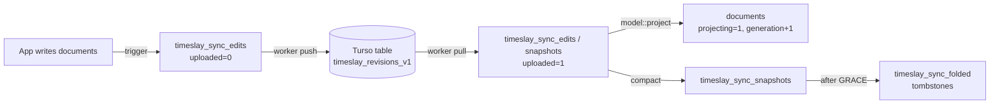

# Database schema

This is a reference for the local SQLite database, every table and trigger in
it, and the JSON stored in its columns. For what the data *means* and how it
fits with Google and the files on disk, see the [data model](./data-model.md).

## The file

There is one database per device:

| Platform | Path |
| --- | --- |
| Linux | `$XDG_DATA_HOME/timeslay/timeslay.sqlite3` (normally `~/.local/share/timeslay/timeslay.sqlite3`) |
| Android | `<app files dir>/data/timeslay/timeslay.sqlite3` |
| Tests | A scratch directory per run (see `config::isolated`) |

The path comes from `task_db::path()` (`core/src/task_db.rs`). Next to it,
`turso/replica.db` is the Turso replica that the sync worker uses. Only the
worker opens that file (see [Turso replica](#turso-replica)).

How the file is opened:

- **Mode `0600`.** The file holds personal data, so `Database::open` restricts
  it to the current user.
- **`PRAGMA foreign_keys = ON`** is set on every connection.
- **`busy_timeout` of 10 s.** The desktop app, the dock, the shortcut daemon,
  the sync worker and the Google write worker all write to the file at once.
  Writes use `BEGIN IMMEDIATE`, so they queue up instead of failing.
- **WAL journal mode.** The UI thread reads without waiting for the sync
  worker's transactions. The file stores the mode once it is set.
  If another connection is mid-transaction, switching fails, the
  version is not stamped, and the next open tries again.

### Versioning

The schema version is stored in `PRAGMA user_version`.

| `user_version` | Meaning |
| --- | --- |
| `0` | New file. `Database::open` creates the schema. |
| `3` | Upgraded to 4 on open: see below. |
| `4` | Current (`task_db::SCHEMA_VERSION`). |
| anything else | Refused: `Unsupported database schema N; expected 4`. |

Every statement in setup is idempotent (`CREATE … IF NOT EXISTS`,
`INSERT OR IGNORE`). Setup runs inside one `IMMEDIATE` transaction, so two
processes setting up at once, or a crash halfway through, cause no harm. Once a
file is stamped with version 4, setup is skipped, because the apps open the
database many times a minute.

**3 → 4** (`Database::remove_write_queue`) removes the old durable Google write
queue. It adds `google_entities.sending_since`, deletes the `google_entities`
rows of edits still waiting in the queue (those items fall back to what Google
has), and drops `google_operations`, `google_operation_progress`, their
triggers and the `google.queue` counter. Edits that never reached Google before
the upgrade are lost; make them again.

An unversioned file whose `tasks` table does not have exactly two columns is
refused with `Unversioned task databases are no longer supported`.

Apart from that, there are no in-place migrations. Large changes are made by one-off scripts
in `scripts/` (for example, `migrate-calendar-tasks.py`), which back up the
file first. `database_migration::backup` makes a verified copy:
it uses SQLite's backup API (which includes WAL contents), writes a SHA-256
manifest and runs an integrity check before publishing the backup.

## Overview

```mermaid
erDiagram
    tasks ||--o{ task_aliases : "task_id"
    tasks ||--o| google_task_backend_state : "task_id (logical)"
    documents ||--o{ timeslay_sync_edits : "journaled by trigger"
    timeslay_sync_snapshots ||--o{ timeslay_sync_edits : "folds (JSON list)"
    timeslay_sync_folded }o--|| timeslay_sync_edits : "tombstone of"

    tasks {
        INTEGER id PK
        TEXT metadata "JSON Metadata"
    }
    task_aliases {
        TEXT source PK "calendar_id/event_id"
        INTEGER task_id FK
    }
    documents {
        TEXT key PK
        TEXT value "JSON"
    }
    calendar_months {
        TEXT month PK "YYYY-MM"
        TEXT events "JSON"
    }
    google_task_records {
        TEXT id PK
        TEXT event "JSON Event"
    }
    google_entities {
        TEXT id PK "calendar NL id"
        TEXT event "JSON Event or NULL"
        TEXT acknowledged_at
        TEXT observed_at
        TEXT sending_since
    }
    google_id_map {
        TEXT local PK
        TEXT remote
        TEXT calendar
    }
    google_task_backend_state {
        INTEGER task_id PK
        TEXT data
    }
    timeslay_change_counters {
        TEXT name PK
        INTEGER value
    }
    timeslay_sync_control {
        INTEGER singleton PK
        INTEGER projecting
        INTEGER generation
    }
    timeslay_sync_edits {
        TEXT id PK
        TEXT document
        TEXT before_json
        TEXT after_json
        INTEGER clock
        INTEGER uploaded
    }
    timeslay_sync_snapshots {
        TEXT id PK
        TEXT document
        TEXT after_json
        INTEGER clock
        TEXT folds
        INTEGER uploaded
        INTEGER seen_at
    }
    timeslay_sync_folded {
        TEXT id PK
        INTEGER remote_deleted
        INTEGER folded_at
    }
```



The only foreign key SQLite enforces is `task_aliases.task_id`. The other
relationships in the diagram are logical: the code keeps them, not
constraints.

The tables fall into five groups:

| Group | Tables | Created by |
| --- | --- | --- |
| [Tasks](#tasks) | `tasks`, `task_aliases` | `task_db::Database::set_up` |
| [Documents](#documents) | `documents` | `task_db::Database::set_up` |
| [Google cache](#google-cache) | `calendar_months`, `google_task_records` | `task_db::Database::set_up` |
| [Google writes](#google-writes) | `google_entities`, `google_id_map`, `google_task_backend_state` | `task_db::Database::set_up` |
| [Change detection](#change-detection) | `timeslay_change_counters` + triggers | `local_changes::install` |
| [Device sync](#device-sync-turso) | `timeslay_sync_control`, `timeslay_sync_edits`, `timeslay_sync_snapshots`, `timeslay_sync_folded` + triggers | `database_sync::enroll`, `database_sync::install_snapshots` |

None of the Google tables are replicated between devices. Only six
`documents` rows are replicated. See
[What is shared between devices](./data-model.md#what-is-shared-between-devices).

---

## Tasks

TimeSlay gives every task a stable integer ID of its own, separate from
Google's IDs. A task's Google ID changes when it moves between Google Tasks and
Google Calendar or between task lists, but its TimeSlay ID stays the same.
This ID is what time blocks, work sessions and recurring copies refer to.

New IDs are random 62-bit integers ≥ 100, so two devices cannot pick the same
ID while offline. Allocation retries until it finds an ID not already in
`tasks`. Files created by older versions may still hold a `counter` table from
when IDs were sequential; nothing reads or writes it any more.

### `tasks`

```sql
CREATE TABLE tasks (
  id       INTEGER PRIMARY KEY,   -- TimeSlay task ID, >= 100
  metadata TEXT NOT NULL          -- JSON: timeblocking::Metadata
);
```

A local **cache** of each task's TimeSlay metadata. The authoritative copy is
kept in Google, alongside the task: in the notes footer for an undated
Google Task, or in `ttData*` extended properties for a dated Calendar task. See
[Task metadata](./data-model.md#task-metadata) for the JSON fields.

### `task_aliases`

```sql
CREATE TABLE task_aliases (
  source  TEXT PRIMARY KEY,                              -- "<calendar_id>/<event_id>"
  task_id INTEGER NOT NULL REFERENCES tasks(id)
);
```

Maps each Google identity a task has had to its TimeSlay ID. `source` is
`timeblocking::block_key(event)`, which is `calendar_id + "/" + id`. For a
Google Task, that is `tasks:<listId>/task:<taskId>`.

A task that moves gets a new alias, and its old aliases stay, so a stale view
holding the old ID still resolves to the same task. Concurrent processes that
import the same Google task agree on one ID (`ON CONFLICT(source) DO NOTHING`
inside an `IMMEDIATE` transaction).

---

## Documents

### `documents`

```sql
CREATE TABLE documents (
  key   TEXT PRIMARY KEY,
  value TEXT NOT NULL      -- JSON (except shared_data_modified_ms, a bare integer)
);
```

This is a key–value store. Each kind of app data is one JSON document.
Use `task_db::read_document` / `write_document` / `remove_document`, or
`shared_data::store` / `overlay` for the `shared.*` keys. Writing directly
bypasses the merge logic described below.

If a document's value does not parse, reading it is an **error**, not an
empty value, so callers can refuse to save over data they could not read.

#### Every key

| Key | Synced | Type (Rust) | Written by | Contents |
| --- | :---: | --- | --- | --- |
| `habits` | ✅ | `habits::Library` | Habits screens (desktop + Android) | Every habit, its daily record, sections and list settings. [Details](./data-model.md#habits) |
| `alarms` | ✅ | `alarms::Library` | Alarms screen | One-shot alarms. [Details](./data-model.md#alarms) |
| `shared.notepad` | ✅ | `config::NotepadText` | Notepad tab | `{"text": "…"}` |
| `shared.brain_dump` | ✅ | `brain_dump::Dumps` | Brain dump | `{"entries": [{"date","text"}]}` |
| `shared.projects` | ✅ | `config::ProjectsSettings` | Life / projects | `{"items": [Project], "areas": [LifeArea]}` |
| `shared.task_work` | ✅ | `task_work::WorkLog` (desktop) | Time-block focus mode | `{"sessions": [...], "distractions": [...]}` |
| `shared_data_modified_ms` | — | integer as text | `shared_data::store` | When a `shared.*` document last changed, in ms since the epoch |
| `contacts` | — | `people::cache::File` | People screen | Raw Google People API responses per signed-in account |
| `routes` | — | `Vec<travel::Stored>` | Desktop travel | Cached Mapbox trip times: `[{from,to,mode,seconds,meters}]` |
| `calendar_sync_state` | — | `day_cache::SyncState` | Calendar refresh | `{"fetched_at", "calendars": [{id,name,color,primary,selected_by_google}]}` |
| `calendar_task_snapshot` | — | `true` | Google task refresh | Marks that `google_task_records` holds a complete task snapshot |
| `dioxus_theme` | — | `String` | Android app | Theme name. The Android home-screen widget reads it directly with SQL (`DayRenderer.kt`) |

`shared.*` documents are written by `shared_data` (`core/src/shared_data.rs`).
On load, the apps lay these documents over the matching `config.toml` sections
(`notepad.text`, `brain_dump`, `projects`, `task_work`). On save, the sections
are taken out of the config and written here instead. An empty section
(only defaults, empty strings, zeros) is **not stored at all**, so a fresh
device cannot overwrite another device's data during sync.

`shared.todos` was the retired scratchpad. Old databases and servers may
still hold it. The sync code skips it and the current triggers do not journal
it.

#### Saving a stale view safely

A screen can hold a document open while a sync from another device changes it
underneath. To avoid losing those changes, `task_db` remembers the last value
each process *read* for each shared key (`database_sync::projection::remember`).
When the process saves, `projection::prepare` checks the stored value. If it
has changed since the read, the save is applied as a diff from the remembered
value onto the current one, using the same field-level merge as sync (see
[Merge rules](#merge-rules)). Remote additions survive, and local deletions
still apply.

---

## Google cache

These tables let a cold start show the calendar right away and let the app
work offline. You can delete their contents at any time. The next refresh
fetches them again.

### `calendar_months`

```sql
CREATE TABLE calendar_months (
  month  TEXT PRIMARY KEY,   -- "YYYY-MM"
  events TEXT NOT NULL       -- JSON: {"events": [SavedEvent]}
);
```

One row per calendar month that has been viewed, holding every event fetched
for it. `SavedEvent` is an [`Event`](./data-model.md#event) with the color
written as four `f32` channels `[r,g,b,a]`, because the UI color type has no
serde support. Times are RFC 3339 with an offset.

The memory cache and this table are trimmed by the same rule: the day in view,
the day either side of it, and the 10 nearest other days are kept
(`calendar::days_to_drop`). `day_cache::clear` empties the table and the
`calendar_sync_state` document together.

### `google_task_records`

```sql
CREATE TABLE google_task_records (
  id    TEXT PRIMARY KEY,   -- Event.id ("task:<googleTaskId>" or a Calendar task id)
  event TEXT NOT NULL       -- JSON: calendar::Event
);
```

The last known copy of every task, both undated Google Tasks and dated Calendar
tasks. Unlike calendar events, tasks are not bound to a month, so they are
kept here. A full refresh replaces the whole table in one transaction
(and sets `calendar_task_snapshot`). Local edits update rows as they are made,
and a write Google refuses puts the previous row back.

---

## Google writes

Every change the user makes to Google data is sent to Google straight away;
there is no queue and nothing is retried. The change is first recorded
locally, so it shows at once, **greyed out and locked** until Google answers.
A worker thread in the same process (`calendar::operations::submit`) then
sends it.

```mermaid
sequenceDiagram
    participant UI
    participant DB as SQLite
    participant W as Write worker (one per process)
    participant G as Google
    UI->>DB: record (one IMMEDIATE tx):<br/>google_entities ← new event JSON, sending_since = now<br/>google_task_records / tasks / task_aliases
    UI->>UI: overlay shows the edit, greyed out and locked
    UI->>W: the Job, over a channel
    W->>W: log "Saving to Google: …"
    W->>G: execute Job
    alt success
        W->>DB: record google_id_map / backend state,<br/>stamp acknowledged_at, clear sending_since
        W->>W: log "Saved to Google: …"
    else failure
        W->>DB: delete the google_entities row,<br/>put the previous google_task_records row back
        W->>W: log "Could not save to Google: …: error"
        UI->>G: fetch again, so the item shows what Google has
    end
    Note over DB: later fetch newer than acknowledged_at<br/>sets observed_at; row pruned 1 h after
```

**Order.** One worker thread per process sends that process's writes one at a
time, in the order they were made, so an edit cannot overtake its item's
creation. Before a job is sent, local IDs in it are rewritten to the IDs Google
has since given those items (`google_id_map`).

**Locking.** An item is locked while its `google_entities.sending_since` is
set. `Overlay::apply` marks such items with `Details::sending` (never stored),
and the interfaces draw them greyed out and ignore clicks and drags on them.
If several writes for one item are in flight, it stays locked until the last
is answered. A row still marked as sending after 10 minutes was cut off (the
app quit or crashed mid-request): it no longer locks the item and the next
fetch deletes it, so the item shows what Google has.

**The log.** Each write is logged when it is sent, saved, or refused
(`operations::log_since`; also `log::info!`/`log::warn!`). The desktop shows
these in **Logs** at the bottom left of the panel, the phone under
**More → Log**. While writes are in flight, the desktop's activity label reads
"Saving to cloud (n)" and the phone shows "Saving…".

**Offline.** With no connection, or signed out, a write fails at once and the
change is undone. Nothing is kept to send later.

Each `operations::Job` is one kind of write. Its label is what the log says:

| Variant | Label | What it does |
| --- | --- | --- |
| `Edit` | Edit event *scope* | Save an edited event (`EditDraft`, recurrence `scope`, description, color) |
| `Time` | Change time | Move or resize an event |
| `Location` | Change location | Set an event's location |
| `Status` | Task status | Active / Completed / Ignored |
| `TaskEdit` | Edit task *change* | Apply one `task_edit::Change` to a task (`Edit task Title`, `Edit task Block`, …) |
| `Delete` / `DeleteTask` | Delete event / Delete task | Delete an event (with scope) or a task |
| `Create` | Create event | New event, optionally with recurrence, projects, options, meeting |
| `CreateTask` / `CreateCalendarTask` | Create task | New undated or dated task |
| `Sleep` | Save sleep | Upsert a sleep night |
| `HabitCompleted` | Habit completion | Patch `ttCompleted` / `ttCompletedAt` on an occurrence |
| `Reply` | Reply to invitation | Accept, decline or tentative |
| `CreateHabit` | Create habit | Create a habit's recurring event |

The label also carries the item's title, for example
`Edit task Title “Buy milk”`. Deleting a time block also unassigns its tasks:
the block's deletion and one `Edit task Unassign` per task are recorded in one
transaction and sent one after another.

### `google_entities`

```sql
CREATE TABLE google_entities (
  id              TEXT PRIMARY KEY,  -- "<calendar_id>\n<event_id>" (newline-separated)
  event           TEXT,              -- JSON: calendar::Event; NULL = deleted locally
  acknowledged_at TEXT,              -- RFC 3339; when Google confirmed the last write
  observed_at     TEXT,              -- RFC 3339 UTC; when a fetch first showed Google agrees
  sending_since   TEXT               -- RFC 3339 UTC; set while a write is on its way to Google
);
```

The **overlay**: the latest state the user wants for each item they have
edited. Each fetched calendar is rendered with these rows laid on top
(`operations::load_overlay`), so an edit shows (locked) while it is being sent
and does not flicker back when a fetch started before Google had it.

Lifecycle of a row:

1. **Recording** a write stores the new `event`, sets `sending_since` and clears
   both other timestamps.
2. **Success** of the item's last write in flight sets `acknowledged_at` and
   clears `sending_since`.
3. **Failure** of the item's last write in flight deletes the row, so the view
   falls back to Google's version.
4. A fetch that **started after** `acknowledged_at` replaces `event` with what
   Google returned and sets `observed_at`.
5. One hour after `observed_at` the row is deleted (`prune_observed`), unless
   a newer write is being sent.

### `google_id_map`

```sql
CREATE TABLE google_id_map (
  local    TEXT PRIMARY KEY,  -- ID the item was created/known under locally
  remote   TEXT NOT NULL,     -- ID Google assigned
  calendar TEXT NOT NULL      -- calendar or task list it now lives on
);
```

Created items get a temporary local ID, and moving a task between Tasks and
Calendar gives it a new Google ID. This map lets the UI keep using the ID it
already knows the item by, and lets a later write that still names the old ID
reach the right item. Task IDs are stored bare (without the `task:` prefix).

### `google_task_backend_state`

```sql
CREATE TABLE google_task_backend_state (
  task_id INTEGER PRIMARY KEY,   -- tasks.id
  data    TEXT NOT NULL          -- JSON: task_db::TaskData
);
```

The `TaskData` Google holds for each task, as confirmed by a successful write
or by a fetch that came after one. Current code only writes this table. It is
a record of the last state known to be on Google, and the migration scripts
also use it.

---

## Change detection

The apps poll the database every couple of seconds to pick up writes from other
processes. Parsing every document on every poll was too expensive, so triggers
increment counters, and a poll only re-reads what has changed
(`local_changes::read`).

### `timeslay_change_counters`

```sql
CREATE TABLE timeslay_change_counters (
  name  TEXT PRIMARY KEY,
  value INTEGER NOT NULL
);
```

| Counter `name` | Incremented by |
| --- | --- |
| `doc:<key>` | Any `INSERT`/`UPDATE`/`DELETE` on `documents` for that key |
| `google.overlay` | Any change to `google_entities` or `google_id_map` (so a write being answered unlocks its item everywhere) |

A counter that has never been incremented reads as `0`.

Triggers (`AFTER` each of `INSERT`, `UPDATE`, `DELETE`):

```
timeslay_change_documents_{insert,update,delete}
timeslay_change_google_entities_{insert,update,delete}
timeslay_change_google_id_map_{insert,update,delete}
```

A trigger body cannot rely on UPSERT or `OR IGNORE`, because the outer
statement's conflict policy overrides the trigger's. Each trigger therefore
runs `INSERT … SELECT … WHERE NOT EXISTS` and then `UPDATE … SET value = value + 1`.

The triggers are part of the file, so a write from an older build that
knows nothing about them still increments the counters.

---

## Device sync (Turso)

Six documents are shared between devices through a Turso sync server
(see `[database_sync] url` in `config.toml`). Sync works as an append-only
**journal of whole-document edits**. Each device merges the journal
deterministically, field by field, and writes the result back into
`documents`. The SQLite file stays an ordinary SQLite file that the Android
widget and older builds can still read.



Only the sync worker, which holds an OS lock, opens the Turso replica.
Credentials, Google caches and device preferences are never replicated.

### `timeslay_sync_control`

```sql
CREATE TABLE timeslay_sync_control (
  singleton  INTEGER PRIMARY KEY CHECK(singleton = 1),
  projecting INTEGER NOT NULL DEFAULT 0,  -- 1 while sync writes documents
  generation INTEGER NOT NULL DEFAULT 0   -- bumped whenever sync changed a document
);
```

- `projecting` is set to 1 while the worker writes the merged result into
  `documents`, so the journal triggers skip those writes and they are not
  journaled again as local edits.
- `generation` lets any process tell cheaply that sync changed data
  (`database_sync::generation()`).

The row exists exactly when the file is **enrolled**. Enrollment is atomic and
happens during schema setup. It also journals the current value of every
shared document present at that moment as the device's first edit.

### `timeslay_sync_edits`

```sql
CREATE TABLE timeslay_sync_edits (
  id          TEXT PRIMARY KEY,          -- 32 hex chars, random
  document    TEXT NOT NULL,             -- documents.key
  before_json TEXT,                      -- whole document before; NULL = absent
  after_json  TEXT,                      -- whole document after;  NULL = deleted
  clock       INTEGER NOT NULL,          -- Lamport-style ordering, >= 1
  uploaded    INTEGER NOT NULL DEFAULT 0 -- 1 once on the server (or received from it)
);
```

There is one row per save of a shared document, written by trigger:

```sql
CREATE TRIGGER timeslay_sync_update AFTER UPDATE ON documents
  WHEN NEW.key IN ('habits','alarms','shared.notepad','shared.brain_dump',
                   'shared.projects','shared.task_work')
   AND (OLD.value IS NOT NEW.value)
   AND (SELECT projecting FROM timeslay_sync_control WHERE singleton=1) = 0
BEGIN
  INSERT INTO timeslay_sync_edits VALUES(
    lower(hex(randomblob(16))), NEW.key, OLD.value, NEW.value,
    (SELECT coalesce(max(clock),0)+1 FROM timeslay_sync_edits), 0);
END;
```

`timeslay_sync_insert` (with `before = NULL`) and `timeslay_sync_delete`
(with `after = NULL`) follow the same pattern. Enrollment drops and recreates
any old trigger that still mentions `shared.todos`.

Rows received from the server are inserted with `uploaded = 1`. If an incoming
ID already exists with different contents, it is a collision: sync stops and
keeps the local data.

### `timeslay_sync_snapshots`

```sql
CREATE TABLE timeslay_sync_snapshots (
  id         TEXT PRIMARY KEY,          -- "snapshot-<32 hex>"
  document   TEXT NOT NULL,
  after_json TEXT,                      -- whole document as of everything folded
  clock      INTEGER NOT NULL,
  folds      TEXT NOT NULL,             -- JSON array of edit/snapshot IDs replaced
  uploaded   INTEGER NOT NULL DEFAULT 0,
  seen_at    INTEGER NOT NULL           -- unix seconds this device first had it
);
```

These rows keep the journal bounded. Once a document has more than
`KEEP + BATCH` (20 + 20) unfolded edits, the worker folds the oldest ones
(only those already on the server) into a snapshot. By construction, the
snapshot projects to the same document. It also folds any earlier snapshots,
so after folding it is the document's only **head**.

If two devices fold at the same moment, there are two heads. The later one by
`(clock, id)` wins. Edits only the losing head covered are still present, and
they replay on top of the winner, so nothing is lost. An unsent local snapshot
that loses a race is withdrawn before it is ever uploaded.

### `timeslay_sync_folded`

```sql
CREATE TABLE timeslay_sync_folded (
  id             TEXT PRIMARY KEY,         -- ID of a deleted edit or snapshot
  remote_deleted INTEGER NOT NULL DEFAULT 0,
  folded_at      INTEGER NOT NULL          -- unix seconds
);
```

Tombstones. Once a snapshot has been the only head on the server for `GRACE`
(1 hour), the edits it covers are deleted locally and recorded here with
`remote_deleted = 0`. The worker then deletes them from the server and sets
`remote_deleted = 1`. Incoming rows whose ID is in this table are ignored, so a
stale copy that arrives late cannot bring back folded history. Tombstones
with `remote_deleted = 1` are removed after 30 days.

### Turso replica

```sql
-- in turso/replica.db, replicated to the server
CREATE TABLE timeslay_revisions_v1 (
  id      TEXT PRIMARY KEY,
  payload TEXT NOT NULL      -- JSON: database_sync::model::Edit
);
```

Every edit and snapshot ever uploaded, as JSON:

```json
{"id":"…","document":"habits","before":"{…}","after":"{…}","clock":42}
{"id":"snapshot-…","document":"habits","before":null,"after":"{…}","clock":61,
 "snapshot":true,"folds":["…","…"]}
```

`snapshot` and `folds` are omitted when they are empty, so an ordinary edit
serializes exactly as older builds wrote it. An older build that does not know
these fields reads a snapshot as a plain edit that sets the whole document,
which gives the same result.

Each cycle does the following:

1. Pull, then read only the server's IDs, and fetch payloads for IDs this
   device has not seen.
2. Apply incoming rows locally, tidy and compact (`apply`), all in one
   `IMMEDIATE` transaction, so saves made during the network round trip are
   merged in, not overwritten.
3. Check that the pending local rows project cleanly, so corrupt input is
   never sent. Then `INSERT OR IGNORE` them and delete folded IDs.
4. Push (if anything changed), mark the rows as uploaded, and checkpoint.

### Merge rules

`database_sync::model::project` replays each document's journal (its primary
snapshot, then every edit not covered by it, ordered by `(clock, id)`). Each
edit is applied as a **diff between `before` and `after`**, not as a
replacement:

- JSON is flattened into paths. Object fields are addressed by name. Array
  items are addressed by a stable identity: the first non-null of `drive_id`,
  `id`, `started_at`, `recorded_at` or `date`, otherwise a SHA-256 of the item.
  Repeated identities get an occurrence suffix (`#0`, `#1`).
- Only paths whose value differs between `before` and `after` are applied.
  Concurrent edits to different fields of the same habit therefore both survive.
- Removing a path removes everything under it, including fields another
  device added at the same time, so deleting an entity cannot leave a broken
  fragment of it behind.
- Array order follows the latest edit's order. Items added concurrently that
  are missing from that order are appended.
- Invalid JSON is an error, never an empty document.

This is why every list item in a shared document carries one of those identity
fields: habits and sections have `id`, alarms have `id`, projects and life areas
have `id`, brain dump entries have `date`, work sessions have `started_at`, and
distractions have `recorded_at`.

---

## Useful queries

```sql
-- Items being sent to Google right now
SELECT replace(id, char(10), ' / ') AS item, sending_since,
       json_extract(event, '$.title') AS title
FROM google_entities WHERE sending_since IS NOT NULL;

-- Local edits not yet sent to the sync server
SELECT document, count(*) FROM timeslay_sync_edits
WHERE uploaded = 0 GROUP BY document;

-- A task's metadata by any Google identity
SELECT t.id, t.metadata FROM tasks t JOIN task_aliases a ON a.task_id = t.id
WHERE a.source = 'tasks:<listId>/task:<taskId>';

-- Size of each document
SELECT key, length(value) FROM documents ORDER BY 2 DESC;

-- Habits by name
SELECT json_extract(h.value,'$.id'), json_extract(h.value,'$.name')
FROM documents d, json_each(d.value,'$.habits') h WHERE d.key='habits';
```

There are also small programs in `core/examples/`:

| Example | Purpose |
| --- | --- |
| `database_backup.rs` | Verified backup of the live database |
| `database_history.rs` | Export every journaled version, including superseded values and deletions |
| `sync_preflight.rs` | Check a sync server without changing it |
| `sync_database.rs` | Enroll and sync without opening a window (`--watch` to keep running) |
