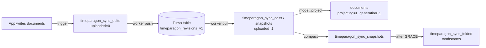

# Database schema

This is a reference for the local SQLite database, every table and trigger in
it, and the JSON stored in its columns. For what the data *means* and how it
fits with Google and the files on disk, see the [data model](./data-model.md).

## The file

There is one database per device:

| Platform | Path |
| --- | --- |
| Linux | `$XDG_DATA_HOME/timeparagon/timeparagon.sqlite3` (normally `~/.local/share/timeparagon/timeparagon.sqlite3`) |
| Android | `<app files dir>/data/timeparagon/timeparagon.sqlite3` |
| Tests | A scratch directory per run (see `config::isolated`) |

The path comes from `task_db::path()` (`core/src/task_db.rs`). Next to it,
`turso/replica.db` is the Turso replica that the sync worker uses. Only the
worker opens that file (see [Turso replica](#turso-replica)).

How the file is opened:

- **Mode `0600`.** The file holds personal data, so `Database::open` restricts
  it to the current user.
- **`PRAGMA foreign_keys = ON`** is set on every connection.
- **`busy_timeout` of 10 s.** The desktop app, the dock, the shortcut daemon,
  the sync worker and the Google write worker all write to the file at once.
  Writes use `BEGIN IMMEDIATE`, so they queue up instead of failing.
- **WAL journal mode.** The UI thread reads without waiting for the sync
  worker's transactions. The file stores the mode once it is set.
  If another connection is mid-transaction, switching fails, the
  version is not stamped, and the next open tries again.

### Versioning

The schema version is stored in `PRAGMA user_version`.

| `user_version` | Meaning |
| --- | --- |
| `0` | New file. `Database::open` creates the schema. |
| `2` through `11` | Upgraded to 12 on open: see below. |
| `6` | Like 5, with the app's tables, indexes and triggers prefixed `timeparagon_` instead of `timeslay_`, and the built-in calendar sources' IDs prefixed `timeparagon:` instead of `timeslay:`. |
| `7` | Adds the synced `notes` metadata table. |
| `8` | Creates the incremental Google sync cache during upgrade and reinstalls synced data tables and triggers. |
| `9` | Removes monthly view snapshots, separates confirmed tasks from desired edits, and tracks changes to all calendar inputs. |
| `10` | Keeps every shared setting in `settings`, and no longer replicates `sleep_nights`. |
| `11` | Normalizes habits, brain dumps and task work; replicates those as native Turso rows. |
| `12` | Current (`task_db::SCHEMA_VERSION`). Habit log entries are keyed by an ID instead of their position (`habit_log_entries` becomes `habit_entries`). |
| anything else | Refused: `Unsupported database schema N; expected 12`. |

Builds from before version 5 refuse a version 5 file, so every TimeParagon
process on a device (panel, dock, shortcut daemon, browser host) has to be
upgraded together, and a device still on an older build stops syncing (it
refuses the settings rows it receives) until it is upgraded.

Every statement in setup is idempotent (`CREATE … IF NOT EXISTS`,
`INSERT OR IGNORE`). Setup runs inside one `IMMEDIATE` transaction, so two
processes setting up at once, or a crash halfway through, cause no harm. Once a
file is stamped with the current version, setup is skipped, because the apps
open the database many times a minute.

**11 → 12** (`relational::migrate_log_entries`) moves each row of
`habit_log_entries`, keyed by `(habit_id, date, kind, position)`, into
`habit_entries`, keyed by `(habit_id, date, id)`; see
[Normalized habits](#normalized-habits-brain-dumps-and-task-work). Each row keeps
its sync token and whether it is still to be sent, under its new key. A
deletion not yet sent cannot be carried over, because the new key comes from
the deleted entry's content, and is dropped. The server's `habit_log_entries`
table is left as it is and no longer read: upgrade every syncing device, since
entries logged by schema 11 builds no longer reach upgraded ones. Rows the
server's new table does not have yet are sent by the first sync (see
[Native row sync](#native-row-sync-and-cutover)).

**9 → 10** (`database_sync::legacy`, run by sync enrollment, so also when
the sync worker opens the file first) retires the nine tables that each held
one kind of setting (`calendar_sources`, `sleep_schedule`,
`sleep_schedule_changes`, `weekly_task_order`, `places`, `event_places`,
`travel_modes`, `travel_routes`, `reminders`). Each row becomes a `settings`
row named as in [Settings](#settings) (`places` row 17 becomes
`travel.places/17`), and the tables and their triggers are dropped. The
journal's edits to those rows are renamed and reshaped the same way, keeping
their IDs, clocks and upload state, so no history is lost and nothing is sent
again. Edits in the old form that arrive later, from the server's history or
from a device still on an older build, are translated as they arrive. The
moved rows are not journaled again: their history already produces them.
If a legacy JSON cell is damaged, this migration rolls back and retains the
original tables and history so the cell can be repaired before retrying.

It also stops replicating `sleep_nights`: their journal triggers are dropped
and their history is deleted, here and (through tombstones) on the server.
Nights still arriving from older devices are dropped the same way. Each
device keeps the nights it has and refreshes them from Google.

Builds expecting schema 9 refuse schema 10, so upgrade the device's app
processes together, and upgrade every syncing device. Incoming edits from an
older device are translated, but older builds cannot reliably consume the new
settings history or snapshots.

**8 → 9** drops `calendar_months` and the `calendar_task_snapshot` marker.
Confirmed Google Tasks are rebuilt from `google_sync_tasks`; pending edits,
stable ID mappings, sync tokens, coverage and sleep records are preserved.
Stored Calendar and sleep event JSON is converted from channel-array colors to
the same `Event` format used by task and local-operation records. New triggers
track source event, task and coverage changes for the shared calendar reader.
The conversion and table removal share the schema transaction; there is no
runtime reader for the retired format.

**7 → 8** creates the six `google_sync_*` tables and the
`google_sync_events_series` index, which were previously created only when
incremental sync ran. It also ensures `sleep_nights`, `notes` and their change
and sync triggers exist. Existing cache rows, tokens, note metadata and sleep
records are preserved; opening the database no longer depends on visiting a
feature to initialize these tables. Builds expecting schema 7 refuse schema 8,
so upgrade the device's app processes together.

**4 → 5** creates the [settings tables](#settings), their journal triggers and
change counters, and an index on `timeparagon_sync_edits(clock)`. Then, for the
device's own database only, it imports `config.toml` once (see
[Upgrading from `config.toml`](./data-model.md#upgrading-from-configtoml)).

**3 → 4** (`Database::remove_write_queue`) removes the old durable Google write
queue. It adds `google_entities.sending_since`, deletes the `google_entities`
rows of edits still waiting in the queue (those items fall back to what Google
has), and drops `google_operations`, `google_operation_progress`, their
triggers and the `google.queue` counter. Edits that never reached Google before
the upgrade are lost; make them again.

An unversioned file whose `tasks` table does not have exactly two columns is
refused with `Unversioned task databases are no longer supported`.

Schema migrations run automatically on open. Some historical data conversions
used one-off scripts in `scripts/`, which back up the file first. `database_migration::backup` makes a verified copy:
it uses SQLite's backup API (which includes WAL contents), writes a SHA-256
manifest and runs an integrity check before publishing the backup.

## Overview

```mermaid
erDiagram
    tasks ||--o{ task_aliases : "task_id"
    tasks ||--o| google_task_backend_state : "task_id (logical)"
    documents ||--o{ timeparagon_sync_edits : "journaled by trigger"
    timeparagon_sync_snapshots ||--o{ timeparagon_sync_edits : "folds (JSON list)"
    timeparagon_sync_folded }o--|| timeparagon_sync_edits : "tombstone of"
    settings ||--o{ timeparagon_sync_edits : "journaled by trigger"

    tasks {
        INTEGER id PK
        TEXT metadata "JSON Metadata"
    }
    task_aliases {
        TEXT source PK "calendar_id/event_id"
        INTEGER task_id FK
    }
    documents {
        TEXT key PK
        TEXT value "JSON"
    }
    google_task_records {
        TEXT id PK
        TEXT event "JSON Event"
    }
    google_entities {
        TEXT id PK "calendar NL id"
        TEXT event "JSON Event or NULL"
        TEXT acknowledged_at
        TEXT observed_at
        TEXT sending_since
    }
    google_id_map {
        TEXT local PK
        TEXT remote
        TEXT calendar
    }
    google_task_backend_state {
        INTEGER task_id PK
        TEXT data
    }
    timeparagon_change_counters {
        TEXT name PK
        INTEGER value
    }
    timeparagon_sync_control {
        INTEGER singleton PK
        INTEGER projecting
        INTEGER generation
    }
    timeparagon_sync_edits {
        TEXT id PK
        TEXT document
        TEXT before_json
        TEXT after_json
        INTEGER clock
        INTEGER uploaded
    }
    timeparagon_sync_snapshots {
        TEXT id PK
        TEXT document
        TEXT after_json
        INTEGER clock
        TEXT folds
        INTEGER uploaded
        INTEGER seen_at
    }
    timeparagon_sync_folded {
        TEXT id PK
        INTEGER remote_deleted
        INTEGER folded_at
    }
    settings {
        TEXT key PK "section.field or section.field/item"
        TEXT value "JSON"
    }
```



The only foreign key SQLite enforces is `task_aliases.task_id`. The other
relationships in the diagram are logical: the code keeps them, not
constraints.

The tables fall into six groups:

| Group | Tables | Created by |
| --- | --- | --- |
| [Tasks](#tasks) | `tasks`, `task_aliases` | `task_db::Database::set_up` |
| [Documents](#documents) | `documents` | `task_db::Database::set_up` |
| [Google cache](#google-cache) | `google_sync_events`, `google_task_records`, `google_sync_windows` | `task_db::Database::set_up` |
| [Google writes](#google-writes) | `google_entities`, `google_id_map`, `google_task_backend_state` | `task_db::Database::set_up` |
| [Settings](#settings) | `settings`, `device_settings` | `settings::schema::CREATE`, from `task_db::Database::set_up` |
| [Change detection](#change-detection) | `timeparagon_change_counters` + triggers | `local_changes::install` |
| [Device sync](#device-sync-turso) | `timeparagon_sync_control`, `timeparagon_sync_edits`, `timeparagon_sync_snapshots`, `timeparagon_sync_folded` + triggers | `database_sync::enroll`, `database_sync::install_snapshots` |

None of the Google tables, nor `sleep_nights`, are replicated between
devices. Four `documents` rows, the rows of `settings` and `notes`, and the normalized habit, brain dump and task work tables are. See
[What is shared between devices](./data-model.md#what-is-shared-between-devices).

---

## Tasks

TimeParagon gives every task a stable integer ID of its own, separate from
Google's IDs. A task's Google ID changes when it moves between Google Tasks and
Google Calendar or between task lists, but its TimeParagon ID stays the same.
This ID is what time blocks, work sessions and recurring copies refer to.

New IDs are random 62-bit integers ≥ 100, so two devices cannot pick the same
ID while offline. Allocation retries until it finds an ID not already in
`tasks`. Files created by older versions may still hold a `counter` table from
when IDs were sequential; nothing reads or writes it any more.

### `tasks`

```sql
CREATE TABLE tasks (
  id       INTEGER PRIMARY KEY,   -- TimeParagon task ID, >= 100
  metadata TEXT NOT NULL          -- JSON: timeblocking::Metadata
);
```

A local **cache** of each task's TimeParagon metadata. The authoritative copy is
kept in Google, alongside the task: in the notes footer for an undated
Google Task, or in `ttData*` extended properties for a dated Calendar task. See
[Task metadata](./data-model.md#task-metadata) for the JSON fields.

### `task_aliases`

```sql
CREATE TABLE task_aliases (
  source  TEXT PRIMARY KEY,                              -- "<calendar_id>/<event_id>"
  task_id INTEGER NOT NULL REFERENCES tasks(id)
);
```

Maps each Google identity a task has had to its TimeParagon ID. `source` is
`timeblocking::block_key(event)`, which is `calendar_id + "/" + id`. For a
Google Task, that is `tasks:<listId>/task:<taskId>`.

A task that moves gets a new alias, and its old aliases stay, so a stale view
holding the old ID still resolves to the same task. Concurrent processes that
import the same Google task agree on one ID (`ON CONFLICT(source) DO NOTHING`
inside an `IMMEDIATE` transaction).

---

## Normalized habits, brain dumps and task work

Schema 11 moves three former documents into typed tables. The table catalog
and exact DDL live in `core/src/relational/mod.rs`; `codec.rs` adapts the
existing Rust models to scalar columns. The public document APIs dispatch
these three legacy keys to the tables, so callers cannot recreate JSON blobs.

| Table | Primary key | Other columns / purpose |
| --- | --- | --- |
| `habit_sections` | `id` | `name`, `collapsed`, `position` |
| `habits` | `id` | Name, kind, creation date, question, notes, color; frequency kind/times/days; display flags, icons, section ID; measure unit/target/days; area ID, distraction flag, position |
| `habit_weekdays` | `habit_id, weekday` | One selected weekday per row, Monday = 0 |
| `habit_days` | `habit_id, date` | `mark`, `repetitions`, `resisted`, `value` in thousandths, `has_log`; NULL preserves the difference between absent and zero |
| `habit_entries` | `habit_id, date, id` | Each happened/resisted entry: `kind`, `position`, `at`, `amount`, `note` |
| `habit_preferences` | `id` (always 1) | Sort, reversal, visibility flags, chart buckets |
| `brain_dump_entries` | `date` | `text`, `position`; empty text is a saved page |
| `task_work_sessions` | `id` | `task_key`, `task_title`, `block_key`, `started_at`, `stopped_at`, `position` |
| `task_work_distractions` | `id` | `block_key`, `minutes`, `recorded_at`, `position` |

A log entry's `id` is a hash of its kind, time, amount and note, numbered
among identical entries that day (`codec::log_entry_id`). Two devices that each
log an entry while offline add two rows, where keying by position made both
write position 0 and kept only one. Changing an entry replaces its row. A day's
entries are read in order of time; `position` orders only entries logged at
the same time, so removing one entry rewrites no others.

Habit children have foreign keys with cascading deletion. Deleting a section
sets its habits' section to NULL. Dates and timestamps use the typed models'
ISO representations. Work row IDs are deterministic hashes of immutable task/
block and timestamp identities plus an occurrence number, preserving identical
legacy distractions. A session's ID remains stable when it stops. Area and
task/block identifiers refer to features outside these normalized tables and
have no local foreign key.

Indexes support habit-date, section, task-session and block-history queries.
The usual change counters watch all these tables, including received writes.
Habit stores remember each editor's baseline, and snapshot saves issue only
row inserts, updates and deletes that changed from that baseline. Unseen rows
remain intact. Same-row changes replace that row as a unit.

### Native row sync and cutover

These nine tables bypass `database_sync::model`, its edit journal, snapshots
and compaction. Each has a corresponding native Turso table with scalar
columns plus `sync_revision` and `sync_deleted`. Native row conflicts use
Turso's last-push-wins policy. Different habits/dates/sessions/distractions
are independent; concurrent changes to the same habit definition, habit day,
log position or brain-dump date have one winner. Received parent deletions
remove dependent local rows even if another device edited those children.
Remote tables omit foreign keys and allow NULL non-key columns for tombstones;
the local projection enforces and validates the relationships transactionally.

`timeparagon_relational_state(table_name,row_key,revision,deleted,dirty)` is a
coalescing outbox and the last received row token. `row_key` encodes only the
primary-key tuple. It contains no before/after payload. Triggers replace the
token on a changed row, acknowledge only the token actually sent, and record
old-key deletion on rekey. Remote tombstones are retained, without a time-based
expiry. Idle pulls scan only keys and tokens; payloads are read for changed
rows. Repeated local updates to one row occupy one state entry. A row this
device holds as sent or received, but of which the server has no trace (not
even a tombstone), is queued to be sent again. Because tombstones never expire,
that only happens to rows the server never had, such as rows an upgrade moved
into a new table, or after the server lost data; rows the server has at
another revision are left to the ordinary exchange.

The migration decodes the former documents in the schema transaction, copies
the originals into local-only `timeparagon_relational_legacy(key,value)`, and
removes their `documents` keys. Invalid or duplicate records abort the upgrade
and preserve the source. `timeparagon_relational_initialized` prevents an old
config import from replacing migrated data. Existing revision history is kept
for recovery, excluded from normal replay/upload, and old cloud IDs are
remembered in `timeparagon_relational_ignored` to avoid fetching them repeatedly.

Before the first row sync, old local/cloud revision history is merged **once**
to seed the native tables. `timeparagon_relational_cutover` is committed with
the initial native rows; `timeparagon_relational_servers` records each device's
preparation per URL. A late-upgrading device starts from native cloud rows and
preserves only local edits made after importing its legacy snapshot. New sync
servers are seeded with existing rows, including previously acknowledged ones.

Upgrade all devices and background processes together. After cutover, edits
made by old builds to the retired documents do not enter native row sync.
No production database is changed by building or testing; the local migration
runs when the updated application opens it.

## Documents

### `documents`

```sql
CREATE TABLE documents (
  key   TEXT PRIMARY KEY,
  value TEXT NOT NULL      -- JSON (except shared_data_modified_ms, a bare integer)
);
```

This is a key–value store for the remaining document-shaped app data.
Use `task_db::read_document` / `write_document` / `remove_document`, or
`shared_data::store` / `overlay` for the `shared.*` keys. Writing directly
bypasses the merge logic described below.

If a document's value does not parse, reading it is an **error**, not an
empty value, so callers can refuse to save over data they could not read.

#### Every key

| Key | Synced | Type (Rust) | Written by | Contents |
| --- | :---: | --- | --- | --- |
| `alarms` | ✅ | `alarms::Library` | Alarms screen | One-shot alarms. [Details](./data-model.md#alarms) |
| `shared.notepad` | ✅ | `config::NotepadText` | Notepad tab | `{"text": "…"}` |
| `shared.projects` | ✅ | `config::ProjectsSettings` | Life / projects | `{"items": [Project], "areas": [LifeArea]}` |
| `shared.routines` | ✅ | `routines::Routines` | Routines (desktop) | `{"entries": [Entry]}`, one per day, week or month. [Details](./data-model.md#routines) |
| `shared_data_modified_ms` | — | integer as text | `shared_data::store` | When a `shared.*` document last changed, in ms since the epoch |
| `contacts` | — | `people::cache::File` | People screen | Raw Google People API responses per signed-in account |
| `routes` | — | `Vec<travel::Stored>` | Desktop travel | Cached Mapbox trip times: `[{from,to,mode,seconds,meters}]` |
| `calendar_sync_state` | — | `repository::SyncState` | Calendar refresh | `{"fetched_at", "calendars": [{id,name,color,primary,selected_by_google}], "notice"}` |
| `dioxus_theme` | — | `String` | Android app | Theme name. Rust publishes it in `widget-day.json`; the Android home-screen widget reads only that snapshot |
| `settings_imported_at` | — | RFC 3339 string | Schema 5 setup | When this database imported `config.toml`, or found none to import. Present means it never imports one again |

`shared_data` (`core/src/shared_data.rs`) writes the remaining `shared.*` documents and routes brain dumps and task work to normalized tables.
The apps' `Config` holds them as `notepad.text`, `brain_dump`, `projects` and
`task_work`, laid in among the [settings](#settings) when those are read; a
save writes back a section that changed. An empty section
(only defaults, empty strings, zeros) is **not stored at all**, so a fresh
device cannot overwrite another device's data during sync.

`shared.todos` was the retired scratchpad. Old databases and servers may
still hold it. The sync code skips it and the current triggers do not journal
it.

#### Saving a stale view safely

A screen can hold a document open while a sync from another device changes it
underneath. To avoid losing those changes, `task_db` remembers the last value
each process *read* for each shared key (`database_sync::projection::remember`).
When the process saves, `projection::prepare` checks the stored value. If it
has changed since the read, the save is applied as a diff from the remembered
value onto the current one, using the same field-level merge as sync (see
[Merge rules](#merge-rules)). Remote additions survive, and local deletions
still apply.

---

## Google cache

These tables let a cold start show the calendar right away and let the app
work offline. You can delete their contents at any time. The next refresh
fetches them again.

### `google_task_records`

```sql
CREATE TABLE google_task_records (
  id    TEXT PRIMARY KEY,   -- Event.id: "task:<googleTaskId>"
  event TEXT NOT NULL       -- JSON: calendar::Event, confirmed data only
);
```

Normalized confirmed Google Tasks, built from the raw incremental task feed.
A successful complete Tasks refresh replaces the table in one transaction;
a failed Tasks refresh preserves its records. Scheduled Calendar tasks belong
to `google_sync_events`. Desired local changes live only in `google_entities`;
a rejected edit reveals the confirmed row without a rollback copy.

All calendar consumers call `calendar::repository::read`. In one read
transaction it reads the confirmed source rows, applies local operations once,
filters the requested dates and sorts the result. `sleep_nights` owns sleep
records; sleep copies in the Google feed are excluded from view assembly.
The result includes explicit date coverage and a database revision. An empty
covered date is a cache hit, and an uncovered date can still show local items.
The UI holds one event set for its loaded range. Navigation and rendering never
write snapshots to the database.

### Incremental Google sync cache

Schema 8 creates these device-local tables before Google sync runs:

| Table | Contents |
| --- | --- |
| `google_sync_meta` | Account identity (`key`, `value`) |
| `google_sync_calendars` | Calendar IDs and their sync tokens |
| `google_sync_windows` | Covered time ranges (`start_at`, `end_at`) |
| `google_sync_events` | Events keyed by calendar and event ID, with series, start/end times, pinned status and event JSON |
| `google_sync_task_lists` | Task list IDs and their update watermarks |
| `google_sync_tasks` | Task JSON keyed by list and task ID |

`google_sync_events_series` indexes `(calendar_id, series)` for refreshing
recurring occurrences. These tables are not replicated. Full sync clears their
rows and rebuilds the cache from Google.

---

## Google writes

Every change the user makes to Google data is sent to Google straight away;
there is no queue and nothing is retried. The change is first recorded
locally, so it shows at once, **greyed out and locked** until Google answers.
A worker thread in the same process (`calendar::operations::submit`) then
sends it.

```mermaid
sequenceDiagram
    participant UI
    participant DB as SQLite
    participant W as Write worker (one per process)
    participant G as Google
    UI->>DB: record (one IMMEDIATE tx):<br/>google_entities ← new event JSON, sending_since = now<br/>tasks / task_aliases
    UI->>UI: overlay shows the edit, greyed out and locked
    UI->>W: the Job, over a channel
    W->>W: log "Saving to Google: …"
    W->>G: execute Job
    alt success
        W->>DB: record google_id_map / backend state,<br/>stamp acknowledged_at, clear sending_since
        W->>W: log "Saved to Google: …"
    else failure
        W->>DB: delete the google_entities row;<br/>confirmed source data remains available
        W->>W: log "Could not save to Google: …: error"
        UI->>G: fetch again, so the item shows what Google has
    end
    Note over DB: later fetch newer than acknowledged_at<br/>sets observed_at; row pruned 1 h after
```

**Order.** One worker thread per process sends that process's writes one at a
time, in the order they were made, so an edit cannot overtake its item's
creation. Before a job is sent, local IDs in it are rewritten to the IDs Google
has since given those items (`google_id_map`). Resolution matches each typed
`Job` variant and changes only Google identities and references; user text and
explicit destination calendars are preserved. Mapping chains are followed to
their final identity, and cycles fail the write with an error.

A task leaving Google Tasks becomes a new Calendar event, named after the
Google Task it leaves (`calendar_tasks::scheduled_id`). The name is chosen
when the edit is recorded, from the ID Google knows the task by then, and the
`TaskEdit` job carries it (`scheduled_as`), so the event shown is the one
Google gets. Only that move and a new dated task create an event; any other
task write to an event Google does not have is refused, never creating a
second copy of the task.

**Execution.** `task_edit::save` and `create_inbox_task` always record local
operations. The worker calls `send_from` and `send_inbox_task` to send them;
the block reconciler calls `send` directly. Creation IDs and original local
task IDs are explicit arguments. Database writes likewise distinguish desired
metadata (`save_desired`) from confirmed remote metadata (`record_remote`),
so confirming an older write cannot overwrite a newer desired edit. No
thread-local replay mode selects these paths.

**Locking.** An item is locked while its `google_entities.sending_since` is
set. `Overlay::apply` marks such items with `Details::sending` (never stored),
and the interfaces draw them greyed out and ignore clicks and drags on them.
If several writes for one item are in flight, it stays locked until the last
is answered. A row still marked as sending after 10 minutes was cut off (the
app quit or crashed mid-request): it no longer locks the item and the next
fetch deletes it, so the item shows what Google has.

**The log.** Each write is logged when it is sent, saved, or refused
(`operations::log_since`; also `log::info!`/`log::warn!`). The desktop shows
these in **Logs** at the bottom left of the panel, the phone under
**More → Logs**. While writes are in flight, the desktop's activity label reads
"Saving to cloud (n)" and the phone shows "Saving…".

**Offline.** With no connection, or signed out, a write fails at once and the
change is undone. Nothing is kept to send later.

Each `operations::Job` is one kind of write. Its label is what the log says:

| Variant | Label | What it does |
| --- | --- | --- |
| `Edit` | Edit event *scope* | Save an edited event (`EditDraft`, recurrence `scope`, description, color) |
| `Time` | Change time | Move or resize an event |
| `Location` | Change location | Set an event's location |
| `Status` | Task status | Active / Completed / Ignored |
| `TaskEdit` | Edit task *change* | Apply one `task_edit::Change` to a task (`Edit task Title`, `Edit task Block`, …) |
| `Delete` / `DeleteTask` | Delete event / Delete task | Delete an event (with scope) or a task |
| `Create` | Create event | New event, optionally with recurrence, projects, options, meeting |
| `CreateTask` / `CreateCalendarTask` | Create task | New undated or dated task |
| `Sleep` | Save sleep | Upsert a sleep night |
| `HabitCompleted` | Habit completion | Patch `ttCompleted` / `ttCompletedAt` on an occurrence |
| `Reply` | Reply to invitation | Accept, decline or tentative |
| `CreateHabit` | Create habit | Create a habit's recurring event |

The label also carries the item's title, for example
`Edit task Title “Buy milk”`. Deleting a time block also unassigns its tasks:
the block's deletion and one `Edit task Unassign` per task are recorded in one
transaction and sent one after another.

### `google_entities`

```sql
CREATE TABLE google_entities (
  id              TEXT PRIMARY KEY,  -- "<calendar_id>\n<event_id>" (newline-separated)
  event           TEXT,              -- JSON: calendar::Event; NULL = deleted locally
  acknowledged_at TEXT,              -- RFC 3339; when Google confirmed the last write
  observed_at     TEXT,              -- RFC 3339 UTC; when a fetch first showed Google agrees
  sending_since   TEXT               -- RFC 3339 UTC; set while a write is on its way to Google
);
```

The **overlay**: the latest state the user wants for each item they have
edited. Each fetched calendar is rendered with these rows laid on top
(`operations::load_overlay`), so an edit shows (locked) while it is being sent
and does not flicker back when a fetch started before Google had it.

Lifecycle of a row:

1. **Recording** a write stores the new `event`, sets `sending_since` and clears
   both other timestamps.
2. **Success** of the item's last write in flight sets `acknowledged_at` and
   clears `sending_since`.
3. **Failure** of the item's last write in flight deletes the row, so the view
   falls back to Google's version.
4. A fetch that **started after** `acknowledged_at` replaces `event` with what
   Google returned and sets `observed_at`.
5. One hour after `observed_at` the row is deleted (`prune_observed`), unless
   a newer write is being sent.

### `google_id_map`

```sql
CREATE TABLE google_id_map (
  local    TEXT PRIMARY KEY,  -- ID the item was created/known under locally
  remote   TEXT NOT NULL,     -- ID Google assigned
  calendar TEXT NOT NULL      -- calendar or task list it now lives on
);
```

Created items get a temporary local ID, and moving a task between Tasks and
Calendar gives it a new Google ID. This map lets the UI keep using the ID it
already knows the item by, and lets a later write that still names the old ID
reach the right item. Task IDs are stored bare (without the `task:` prefix).

### `google_task_backend_state`

```sql
CREATE TABLE google_task_backend_state (
  task_id INTEGER PRIMARY KEY,   -- tasks.id
  data    TEXT NOT NULL          -- JSON: task_db::TaskData
);
```

The `TaskData` Google holds for each task, as confirmed by a successful write
or by a fetch that came after one. Current code only writes this table. It is
a record of the last state known to be on Google, and the migration scripts
also use it.

---

## Settings

The settings both apps keep, which used to be `config.toml`. What each one
means is in the [data model](./data-model.md#settings). The tables are
described once in `settings::schema`, which the settings code and sync both
use; a test checks the description against the tables created.

```sql
-- Named "section.field", or "section.field/item" for an item of a
-- collection. Only values that differ from the built-in default are stored.
-- Shared.
CREATE TABLE settings (
  key   TEXT PRIMARY KEY,        -- "calendar.weekly_day_width", "travel.places/1730000000000"
  value TEXT NOT NULL            -- JSON: 200, "Ocean", {"volume":70,…}
);
-- The same, for what describes this device. Never leaves it.
CREATE TABLE device_settings (key TEXT PRIMARY KEY, value TEXT NOT NULL);
```

A collection whose items have an identity is stored one row per item, so
devices merge it item by item (`settings::mapping::COLLECTIONS`). The item's
name is what identifies it, its parts joined by `/`, and the value is the
item as the apps' `Config` holds it:

| Key | Value |
| --- | --- |
| `calendar.sources/<id>` | `{"hidden":true,"position":2,"color":"#RRGGBB"}` for a Google calendar, `tasks:<list>`, `tasks:` or `timeparagon:habits`, …: whether it is switched off in the calendar menu, its left-to-right order for overlapping events (`null` = unordered) and its color (`null` = its own). The apps' `calendar.disabled`, `source_order`, `task_colors` and `calendar_colors` |
| `calendar.sleep_schedule/<weekday>` | `{"bedtime":"23:00:00","wakeup":"07:00:00"}`. `0` is Monday: the night ending that day. A weekday at the default has no row |
| `calendar.sleep_schedule_changes/<from>` | `{"from":"YYYY-MM-DD","previous":{…},"times":{…}}`: from the night `from` on, its weekday has `times` instead of `previous` |
| `calendar.weekly_task_order/<day>` | The card IDs in a column of the week board, in order |
| `travel.places/<id>` | `{"id","name","address","place_id","lat","lng","favorite"}`. `id` is ms since the epoch when saved, and what tasks refer to; `place_id` is Mapbox's ID (older: Google's) |
| `travel.event_places/<event id>` | The ID of the event's place |
| `travel.modes/<from>/<to>` | `{"from","to","mode"}`, `mode` being `walk`, `bike` or `car` |
| `travel.routes/<from>/<to>/<mode>` | `{"from","to","mode","seconds","meters"}` |

Each kind of reminder is an ordinary setting, `reminders.<kind>`.

- **Absent means default.** No row is stored for a value, or an item, that
  holds the default.
- **References are not enforced.** Travel items and the `travel.home`
  setting name places by ID, but nothing stops the place going: sync must be
  able to store whatever two devices did at once. Readers skip a place that
  is gone.
- **Write through `settings`** (`save` with a baseline, or `update`). It
  writes only what changed, in one `IMMEDIATE` transaction, and merges a
  change into the stored value as sync would, so another process's edit to a
  different field of the same item is kept. JSON that does not parse cannot
  be written by the apps at all: the journal triggers refuse it.

## Change detection

The apps poll the database every couple of seconds to pick up writes from other
processes. Parsing every document on every poll was too expensive, so triggers
increment counters, and a poll only re-reads what has changed
(`local_changes::read`).

### `timeparagon_change_counters`

```sql
CREATE TABLE timeparagon_change_counters (
  name  TEXT PRIMARY KEY,
  value INTEGER NOT NULL
);
```

| Counter `name` | Incremented by |
| --- | --- |
| `doc:<key>` | Any `INSERT`/`UPDATE`/`DELETE` on `documents` for that key |
| `google.overlay` | Any change to `google_entities` or `google_id_map` (so a write being answered unlocks its item everywhere) |
| `settings` | Any change to `settings` or `device_settings`, by an app or by sync |

`Counters::config` is `settings` plus the `doc:` counters of the four
`shared.*` documents: it moves whenever anything the apps' `Config` holds
changes. The desktop's watchers (panel and dock) read it about three times a
second over one connection (`local_changes::Reader`), and the phone every two
seconds, and only then read the settings again.

A counter that has never been incremented reads as `0`.

Triggers (`AFTER` each of `INSERT`, `UPDATE`, `DELETE`):

```
timeparagon_change_documents_{insert,update,delete}
timeparagon_change_google_entities_{insert,update,delete}
timeparagon_change_google_id_map_{insert,update,delete}
timeparagon_change_<settings table>_{insert,update,delete}
```

A trigger body cannot rely on UPSERT or `OR IGNORE`, because the outer
statement's conflict policy overrides the trigger's. Each trigger therefore
runs `INSERT … SELECT … WHERE NOT EXISTS` and then `UPDATE … SET value = value + 1`.

The triggers are part of the file, so a write from an older build that
knows nothing about them still increments the counters.

---

## Device sync (Turso)

Four documents and the rows of `settings` and `notes` use the revision
transport below. Habits, brain dumps and task work instead use
[native row sync](#native-row-sync-and-cutover). Both use the Turso server in
`database_sync.url`. The revision transport works as an append-only **journal of whole-document edits**, a settings
row counting as a document of its own (see [Settings rows](#settings-rows)). Each device merges the journal
deterministically, field by field, and writes the result back into
`documents`. The SQLite file stays an ordinary SQLite file that the Android
widget can still read. Schema 10 clients must upgrade before reopening it.



Only the sync worker, which holds an OS lock, opens the Turso replica.
Credentials, Google caches and device preferences are never replicated.

### `timeparagon_sync_control`

```sql
CREATE TABLE timeparagon_sync_control (
  singleton  INTEGER PRIMARY KEY CHECK(singleton = 1),
  projecting INTEGER NOT NULL DEFAULT 0,  -- 1 while sync writes documents
  generation INTEGER NOT NULL DEFAULT 0   -- bumped whenever sync changed a document
);
```

- `projecting` is set to 1 while the worker writes the merged result into
  `documents`, so the journal triggers skip those writes and they are not
  journaled again as local edits.
- `generation` lets any process tell cheaply that sync changed data
  (`database_sync::generation()`).

The row exists exactly when the file is **enrolled**. Enrollment is atomic and
happens during schema setup. It also journals the current value of every
shared document present at that moment as the device's first edit.

### `timeparagon_sync_edits`

```sql
CREATE TABLE timeparagon_sync_edits (
  id          TEXT PRIMARY KEY,          -- 32 hex chars, random
  document    TEXT NOT NULL,             -- documents.key
  before_json TEXT,                      -- whole document before; NULL = absent
  after_json  TEXT,                      -- whole document after;  NULL = deleted
  clock       INTEGER NOT NULL,          -- Lamport-style ordering, >= 1
  uploaded    INTEGER NOT NULL DEFAULT 0 -- 1 once on the server (or received from it)
);
```

There is one row per save of a shared document, written by trigger. `clock`
is indexed (`timeparagon_sync_edits_clock`), since every trigger reads its maximum:

```sql
CREATE TRIGGER timeparagon_sync_update AFTER UPDATE ON documents
  WHEN NEW.key IN ('habits','alarms','shared.notepad','shared.brain_dump',
                   'shared.projects','shared.task_work','shared.routines')
   AND (OLD.value IS NOT NEW.value)
   AND (SELECT projecting FROM timeparagon_sync_control WHERE singleton=1) = 0
BEGIN
  INSERT INTO timeparagon_sync_edits VALUES(
    lower(hex(randomblob(16))), NEW.key, OLD.value, NEW.value,
    (SELECT coalesce(max(clock),0)+1 FROM timeparagon_sync_edits), 0);
END;
```

`timeparagon_sync_insert` (with `before = NULL`) and `timeparagon_sync_delete`
(with `after = NULL`) follow the same pattern. Enrollment drops and recreates
any trigger whose list of keys is not the current one: an old one that still
mentions `shared.todos`, or one from before a document was shared (such as
`shared.routines`), so the new document is journaled from then on.

Rows received from the server are inserted with `uploaded = 1`. If an incoming
ID already exists with different contents, it is a collision: sync stops and
keeps the local data.

### Settings rows

Each row of a synced table (`settings`, `notes`) is a document of its own in
the journal, named after its table and primary key as a JSON array:

| Document | Row |
| --- | --- |
| `settings:["calendar.weekly_day_width"]` | `{"key":"calendar.weekly_day_width","value":200}` |
| `settings:["travel.places/1730000000000"]` | `{"key":"travel.places/1730000000000","value":{"id":1730000000000,"name":"Home",…}}` |
| `notes:["n1"]` | `{"id":"n1","color":"rose","links":[…]}` |

The value is the row as `json_object(…)` of its columns, with JSON columns
(`settings.value`, `notes.links`) embedded as JSON rather than as text. So the
[merge rules](#merge-rules) apply unchanged: concurrent edits to different
fields of one value both survive (a place renamed on one device and starred
on another), a deleted row stays deleted whatever was edited in it
meanwhile, and each row is snapshotted and compacted on its own.

Builds before schema 10 named the rows of their settings tables the same way
(`places:[1730000000000]`). Those edits are translated to `settings` rows
when they are found or arrive (see the [upgrade to 10](#versioning)).

Four triggers per table journal what the apps do (`database_sync::rows`):
`timeparagon_sync_<table>_insert`, `_update` (when the row changed),
`_rekey` (a changed primary key journals a deletion and an insertion) and
`_delete`. Like the document triggers they skip writes made while
`projecting = 1`. Enrollment creates them, replacing any that differ from
what the build would create, and journals rows already present when a file
is first enrolled. `device_settings` has none.

When applying the journal, the worker writes a row only when a column the
journal holds differs from the table (columns the journal lacks, from an
older build, are not compared), so a settled row is not rewritten every
cycle.

### `timeparagon_sync_snapshots`

```sql
CREATE TABLE timeparagon_sync_snapshots (
  id         TEXT PRIMARY KEY,          -- "snapshot-<32 hex>"
  document   TEXT NOT NULL,
  after_json TEXT,                      -- whole document as of everything folded
  clock      INTEGER NOT NULL,
  folds      TEXT NOT NULL,             -- JSON array of edit/snapshot IDs replaced
  uploaded   INTEGER NOT NULL DEFAULT 0,
  seen_at    INTEGER NOT NULL           -- unix seconds this device first had it
);
```

These rows keep the journal bounded. Once a document has more than
`KEEP + BATCH` (20 + 20) unfolded edits, the worker folds the oldest ones
(only those already on the server) into a snapshot. By construction, the
snapshot projects to the same document. It also folds any earlier snapshots,
so after folding it is the document's only **head**.

If two devices fold at the same moment, there are two heads. The later one by
`(clock, id)` wins. Edits only the losing head covered are still present, and
they replay on top of the winner, so nothing is lost. An unsent local snapshot
that loses a race is withdrawn before it is ever uploaded.

### `timeparagon_sync_folded`

```sql
CREATE TABLE timeparagon_sync_folded (
  id             TEXT PRIMARY KEY,         -- ID of a deleted edit or snapshot
  remote_deleted INTEGER NOT NULL DEFAULT 0,
  folded_at      INTEGER NOT NULL          -- unix seconds
);
```

Tombstones. Once a snapshot has been the only head on the server for `GRACE`
(1 hour), the edits it covers are deleted locally and recorded here with
`remote_deleted = 0`. The worker then deletes them from the server and sets
`remote_deleted = 1`. Incoming rows whose ID is in this table are ignored, so a
stale copy that arrives late cannot bring back folded history. Tombstones
with `remote_deleted = 1` are removed after 30 days.

### Turso replica

```sql
-- in turso/replica.db, replicated to the server
CREATE TABLE timeparagon_revisions_v1 (
  id      TEXT PRIMARY KEY,
  payload TEXT NOT NULL      -- JSON: database_sync::model::Edit
);
```

Every edit and snapshot ever uploaded, as JSON:

```json
{"id":"…","document":"habits","before":"{…}","after":"{…}","clock":42}
{"id":"snapshot-…","document":"habits","before":null,"after":"{…}","clock":61,
 "snapshot":true,"folds":["…","…"]}
```

`snapshot` and `folds` are omitted when they are empty, so an ordinary edit
serializes exactly as older builds wrote it. An older build that does not know
these fields reads a snapshot as a plain edit that sets the whole document,
which gives the same result.

Each cycle does the following:

1. Pull, then read only the server's IDs, and fetch payloads for IDs this
   device has not seen.
2. Apply incoming rows locally, tidy and compact (`apply`), all in one
   `IMMEDIATE` transaction, so saves made during the network round trip are
   merged in, not overwritten.
3. Check that the pending local rows project cleanly, so corrupt input is
   never sent. Then `INSERT OR IGNORE` them and delete folded IDs.
4. Push (if anything changed), mark the rows as uploaded, and checkpoint.

### Merge rules

`database_sync::model::project` replays each document's journal (its primary
snapshot, then every edit not covered by it, ordered by `(clock, id)`). Each
edit is applied as a **diff between `before` and `after`**, not as a
replacement:

- JSON is flattened into paths. Object fields are addressed by name. Array
  items are addressed by a stable identity: the first non-null of `drive_id`,
  `id`, `started_at`, `recorded_at` or `date`, otherwise a SHA-256 of the item.
  Repeated identities get an occurrence suffix (`#0`, `#1`).
- Only paths whose value differs between `before` and `after` are applied.
  Concurrent edits to different fields of the same project therefore both survive.
- Removing a path removes everything under it, including fields another
  device added at the same time, so deleting an entity cannot leave a broken
  fragment of it behind.
- Array order follows the latest edit's order. Items added concurrently that
  are missing from that order are appended.
- Invalid JSON is an error, never an empty document.

This is why every list item in a shared document carries one of those identity
fields: alarms, projects, life areas, routine entries, objectives and highlights
have `id`, while daily refreshes have `recorded_at`. The normalized tables do
not use these merge rules.

---

## Useful queries

```sql
-- Items being sent to Google right now
SELECT replace(id, char(10), ' / ') AS item, sending_since,
       json_extract(event, '$.title') AS title
FROM google_entities WHERE sending_since IS NOT NULL;

-- Local edits not yet sent to the sync server
SELECT document, count(*) FROM timeparagon_sync_edits
WHERE uploaded = 0 GROUP BY document;

-- A task's metadata by any Google identity
SELECT t.id, t.metadata FROM tasks t JOIN task_aliases a ON a.task_id = t.id
WHERE a.source = 'tasks:<listId>/task:<taskId>';

-- Size of each document
SELECT key, length(value) FROM documents ORDER BY 2 DESC;

-- Settings that are not at their defaults, shared and this device's own
SELECT 'shared', key, value FROM settings
UNION ALL SELECT 'device', key, value FROM device_settings ORDER BY 2;

-- Settings rows not yet sent to the sync server, by table
SELECT substr(document, 1, instr(document, ':') - 1) AS tbl, count(*)
FROM timeparagon_sync_edits WHERE uploaded = 0 AND document GLOB '*:*' GROUP BY tbl;

-- Habits by name
SELECT id, name FROM habits ORDER BY position;

-- Work time by task (completed sessions only)
SELECT task_key, sum(unixepoch(stopped_at)-unixepoch(started_at)) AS seconds
FROM task_work_sessions WHERE stopped_at IS NOT NULL GROUP BY task_key;

-- Native row changes waiting for sync
SELECT table_name, count(*) FROM timeparagon_relational_state
WHERE dirty=1 GROUP BY table_name;
```

There are also small programs in `core/examples/`:

| Example | Purpose |
| --- | --- |
| `database_backup.rs` | Verified backup of the live database |
| `import_settings.rs` | Import a `config.toml` into a database (try it on copies) |
| `database_history.rs` | Export every journaled version, including superseded values and deletions |
| `sync_preflight.rs` | Check a sync server without changing it |
| `sync_database.rs` | Enroll and sync without opening a window (`--watch` to keep running) |

## Notes metadata

```sql
CREATE TABLE notes (
    id TEXT PRIMARY KEY,
    color TEXT NOT NULL DEFAULT 'butter',
    links TEXT NOT NULL DEFAULT '[]'
);
```

One row per Markdown note, keyed by the stable `id` in its front matter.
`color` is a pastel name; `links` is a JSON array of connections (`kind`, `id`,
`title`, optional `day`). Rows are replicated through the database sync journal.
Titles and text stay in the Markdown files; filenames and folder paths are not
stored in this table. The notes folder remains a device setting.

Opening a notes folder imports legacy `color` and `links` front matter, adds
missing IDs, and rewrites the migrated files after committing their metadata.
Existing database metadata takes precedence on repeat imports. All unused front
matter is removed, leaving only `id`. Explicit note deletion removes the row; an externally
missing file leaves metadata intact to tolerate delays in folder sync.
